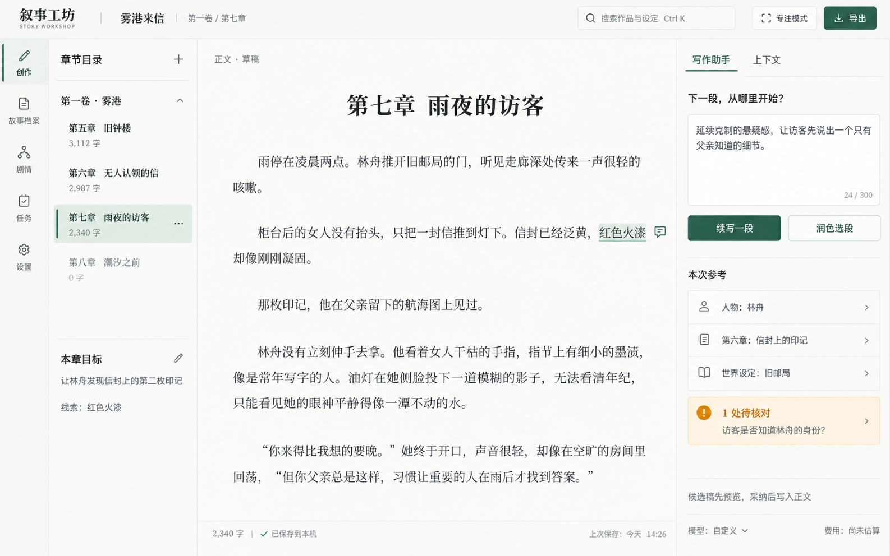
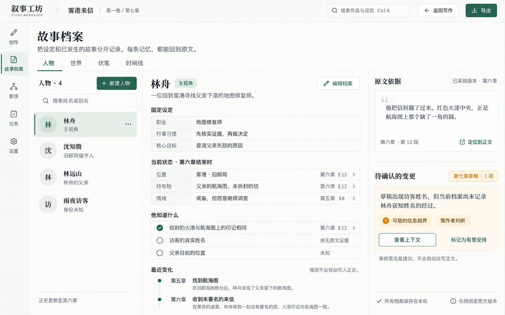
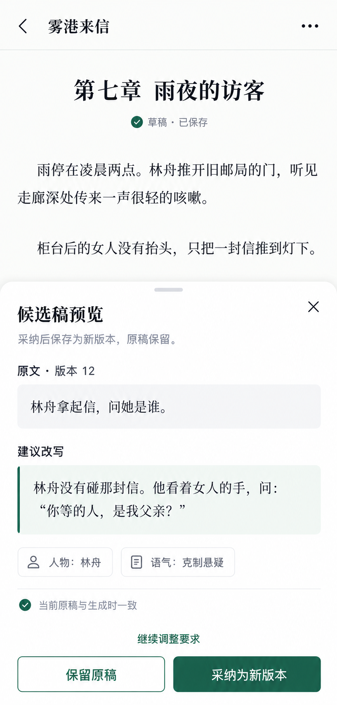

# 叙事工坊 · Story Workshop

项目仓库：[spark0v0/Inkloom](https://github.com/spark0v0/Inkloom)。

一个面向中文长篇小说作者的 AI 创作工作台：作者决定故事，AI 协助构思、起草、校对与整理记忆。

**当前版本：0.1.0 本地测试版。** 已有可运行的前后端、SQLite 持久化、手动写作与版本、AI 候选、来源记忆和备份恢复。真实云模型与文学效果尚未评测；演示响应始终标记为演示。实际验证与限制见 [IMPLEMENTATION.md](docs/IMPLEMENTATION.md)。

## 本地启动

Windows 使用 PowerShell 7，需要 Node.js 22.12+、Python 3.13+ 与 uv。初次准备后启动：

```powershell
pwsh -File .\scripts\setup.ps1
pwsh -File .\scripts\start.ps1
```

打开 **http://127.0.0.1:8765**。已有依赖和构建时直接运行 `start.ps1`；更新前端后用 `start.ps1 -Build`。按 Ctrl+C 结束。默认作品目录是项目中的 `data/`，请不要删除它来解决启动问题。

```powershell
pwsh -File .\scripts\start.ps1 -Port 8766 -DataDirectory D:\StoryWorkspace
pwsh -File .\scripts\dev.ps1           # 热更新；请先停止占用 8765 的预览
pwsh -File .\scripts\test.ps1          # Ruff / pytest / 契约同步 / Vitest / 类型 / 构建
pwsh -File .\scripts\test.ps1 -Browser # 另外运行真实 Chrome 桌面和手机视口流程
```

测试每次使用新建的 `.tmp/` 工作区；浏览器测试服务监听本机 9876 端口，默认使用本机 Chrome。无需 Docker、Redis、向量服务或云账户。接口变更后运行 `npm --prefix frontend run generate:api`，`check:api` 可检查声明漂移。

## 第一次使用

1. 新建作品，或打开原创示例《雾港来信》。没有 API Key 也能手写、保存、查看版本和导出。
2. 正文停止输入后自动保存，也可按 Ctrl+S；只有服务确认后才显示“已保存到工作区”。离线或版本冲突会保留文字并提供恢复入口。
3. 在“故事档案”记录人物、别名、世界、伏笔与时间线；在“剧情规划”记录作品方向、文风与场景。
4. 写作助手支持续写、选段改写、场景规划、变化提取、一致性审稿和前章交接。发送前可查看上下文及估算，流式片段与任务会持久化。
5. 候选稿比较后才能采纳为新正文版本；原稿更新后，旧候选不能直接覆盖。部分输出不能直接采纳。
6. “确认正史”是另一项操作：核对当前章与带出处的变化，依次确认前文。修改已确认章节，会让相应后缀记忆和检索失效，旧版本仍可查。
7. 页头导出 TXT / Markdown；“工作区备份”导出完整快照。恢复在新目录校验后切换，原工作区保留。

“字数”按非 Unicode White_Space 的码点计数，包含标点、字母；组合 emoji 可能由多个码点组成。前后端使用 [相同样例](docs/contracts/text-fixtures.json)。

## 连接模型

“模型设置”支持 **Chat Completions 兼容接口**。填写基础地址、精确模型 ID、密钥和服务实际支持的流式、usage、JSON mode、输出上限参数。支持明确配置的本机或云服务，不会跨服务商自动回退。

密钥仅交给本机后端，Windows 使用 DPAPI 加密保管，不回传前端、不随备份导出。也可填写启动环境的密钥变量名，恢复备份后需重新配置凭证。不要在聊天或仓库中发送真实密钥。“检查连接”只查询模型列表，不执行付费生成，也不证明全部协议能力。

价格按用户配置的单价、币种和确认日期估算；缺少价格或 usage 时费用保留未知。任务有调用次数与可选金额上限，失败需明确重试，上游执行未知时不自动重发。

**选中的小说上下文会发送到你配置的模型服务。** 本地存储不意味着云模型处理也完全离线。演示模型为固定本地样例，不能用于评价文学质量。

## 从这里开始

| 文件 | 用途 |
| --- | --- |
| [实际实现与验证](docs/IMPLEMENTATION.md) | 本版能力、检查证据与重要限制 |
| [实现决策](docs/adr/0001-local-workspace.md) | 实际模块、数据契约与规划差异 |
| [UI 实现说明](docs/design/IMPLEMENTATION-DESIGN.md) | 新概念图、参考取舍与组件映射 |
| [AGENTS.md](AGENTS.md) | 后续开发代理必须遵守的项目约束 |
| [START_PROMPT.md](START_PROMPT.md) | 可直接交给开发代理的完整启动提示词 |
| [调研报告](docs/RESEARCH.md) | 9 个 GitHub 项目、Linux DO 讨论、来源限制与产品判断 |
| [产品方案](docs/PRODUCT.md) | 定位、使用流程、P0/P1/P2 范围与产品行为 |
| [技术方案](docs/ARCHITECTURE.md) | 推荐技术栈、数据契约、正史与记忆、任务恢复、接口与安全 |
| [开发路线](docs/ROADMAP.md) | 按依赖推进的里程碑、交付物与验收入口 |
| [验收与评测](docs/ACCEPTANCE.md) | 数据安全、功能、失败恢复、模型效果与性能的检查方法 |
| [AI 写作提示词](docs/AI-WRITING-PROMPTS.md) | 六类运行时任务模板，独立于开发代理指令 |
| [UI 设计规范](docs/design/DESIGN.md) | 三张概念图、视觉变量、响应式行为、状态与实现映射 |
| [生图提示词](docs/design/IMAGE-PROMPTS.md) | 本轮使用的完整提示词与图片来源 |
| [来源快照](docs/research/sources.json) | 调研日期、仓库分支、commit、许可证与原始链接 |
| [本轮交付记录](docs/DELIVERY.md) | 实际产物、已经做的检查和仍未验证的范围 |

## 产品方向

1. 先交付可以长期使用的编辑器，再完善 AI 流程。没有 API Key 也能创建作品、写作、保存和导出。
2. AI 输出先进入候选稿；采纳为正文与确认为正史是两个明确动作。
3. 已发生事实、作者设定、未来计划与模型推测分别管理，记忆保留原文版本和引用。
4. 本地优先，默认单用户、回环地址访问；调用云端模型时，选中的上下文会发送给配置的服务商。
5. 任务、部分产物、版本和恢复信息持久化。正文不因断线、重试或错误覆盖而丢失。

工作名称暂定为“叙事工坊”，尚未进行商标或名称可用性检索。实际技术栈为 **React + TypeScript + Vite + Tiptap / FastAPI + SQLite**，精确版本见前后端锁文件。

## UI 概念图

图片中的小说、人物、字数和状态均为虚构示例，不代表实际软件或模型运行结果。

开发阶段先生成了新版 [写作工作台](docs/design/ui-workspace-v2.png) 与 [作品书架](docs/design/ui-library-v2.png)，再实现独立组件。完整提示词见 [UI-V2-IMAGE-PROMPTS.md](docs/design/UI-V2-IMAGE-PROMPTS.md)，真实页面截图在 `docs/screenshots/`，与以下早期概念分开。

### 桌面写作工作台



### 故事档案与原文依据



### 移动端候选稿采纳



## 下一步

继续开发前先阅读 [实际实现与验证](docs/IMPLEMENTATION.md)；[START_PROMPT.md](START_PROMPT.md) 保留原始开发目标。图片只作布局和视觉参考，应用使用真实组件与数据。

尚未提供云同步、多人协作、完整分支、自动发布、EPUB / DOCX 或非兼容原生模型协议。实际 Windows 输入法人工验收、跨浏览器、百万字性能和真实长篇效果需继续独立验证。

本项目独立实现，源码仓库为 [Inkloom](https://github.com/spark0v0/Inkloom)。小说数据、密钥和本地运行目录不进入版本控制；尚未发布公网服务，发行许可留待后续确定。
