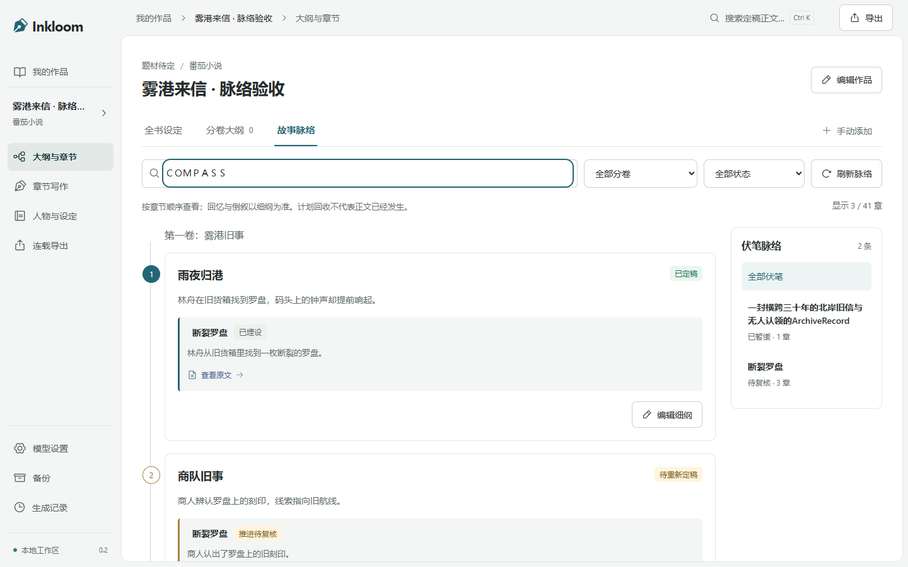
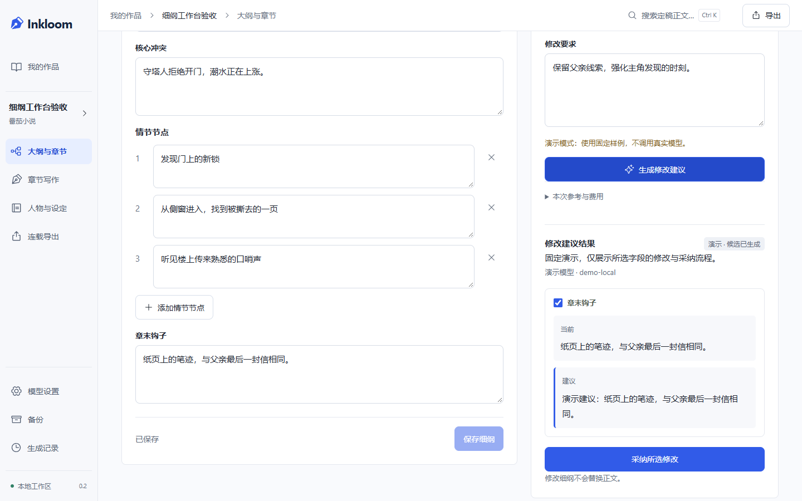
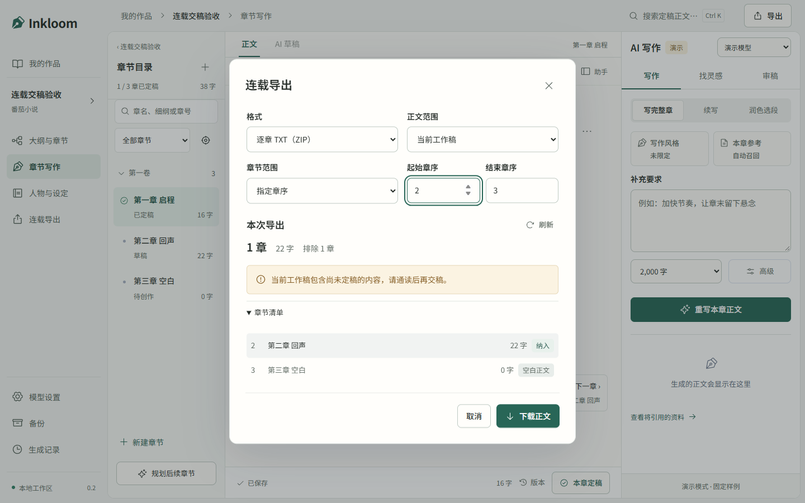

# Inkloom

面向中文长篇连载的 AI 小说创作工作台。接入自己的模型，从故事想法开始，规划全书、生成章节、审稿修稿、整理记忆，最后导出稿件。作者决定采用什么，已有正文保留版本。

**当前为 0.2.0 本地测试版。** 支持面向番茄、起点等平台的创作目标和稿件导出，发布由作者自行完成。真实长篇成稿质量与费用仍待评测；演示模型只用于体验固定流程。

[本地启动](#本地运行) · [三章试写指南](docs/START-WRITING.md) · [最新流程复查与结项判断](docs/REVIEW-WORKFLOW-2026-10-31.md) · [阶段竞品对照](docs/PROJECT-CLOSEOUT-2026-10-31.md) · [当前限制](#当前限制)

最新流程复查修复了历史记录较多时恢复不到候选、分卷任务恢复范围、重复定稿无故影响后章，以及定稿记忆并发覆盖和回执未确认的问题。再次打开定稿会恢复作者已确认的记忆，冲突时保留本页选择并比较最新记录。实现及验证见 [连续创作流程复查](docs/REVIEW-WORKFLOW-2026-10-31.md)；真实模型连续创作与费用尚未验收。

此前的代码复查还修复了请求与备份解压的资源边界、异常会话和损坏备份的错误处理，以及写作助手误显示规划讨论的问题；具体发现与实际验证见 [前一轮记录](docs/REVIEW-CLOSEOUT-2026-10-31.md)。

## 可以做什么

| 创作环节 | 当前能力 |
| --- | --- |
| 开书与规划 | AI 全书方案、网文主角小传模板、世界设定与**人物关系图谱**，按卷分批规划章节；持续讨论所选细纲，审阅并采纳修改建议；细纲支持手动编辑与版本历史 |
| 整章写作 | 按细纲生成整章、续写、**场景起承转合四步节拍**、重写；多角色同场登场时**自动注入人际关系硬约束防 OOC**；输出先进入候选，作者采纳后才形成正文新版本 |
| 卡剧情与修稿 | 比较三个剧情方向，再按选定方向续写；选段润色、扩写、缩写；从单条审稿意见准备对应段落改写 |
| 长篇资料 | 本章必读参考、作品文风、带原文依据的记忆、**人物羁绊网络**（一度人际圈拓扑聚焦、双层自适应环形布局、网文关系预设），以及伏笔埋设/推进/回收；故事脉络支持按章查看、筛选和进入细纲编辑 |
| 模型接入 | 内置 **2026 最新主流模型一键预设**（DeepSeek-V3 / R1 满血版、Claude 3.7 Sonnet / Thinking、Gemini 2.5 Pro / Flash、阿里通义千问 Qwen 2.5、Moonshot Kimi 等），免去手动填写复杂参数与价格预估 |
| 保存与交付 | 自动保存、浏览器恢复副本、版本冲突保护、生成历史与中断片段；按章节范围预览并导出 TXT/Markdown/按章 TXT 压缩包，支持备份与恢复 |

### 重点创作增强

- 新增 **作家级行内微操作工具箱 (Craft Toolbox) 与非阻塞写作流**：参考 Sudowrite 与 Novelcrafter 设计，在编辑器中选中文本直接呼出专业网文微操作（**打斗动作强化**、**围观震惊反响**、**五感细节扩写**、**紧凑霸气对白**、**润色精修**、**精炼去水**），一键唤起即时改写；划词可直接“+ 记为设定”瞬间保存配角与世界观，无需跳出编辑器；彻底解除前章未定稿禁止后章写作的硬锁，保障日更连载心流。详见 [架构决策 ADR 0025](docs/decisions/0025-author-centric-craft-and-brainstorm.md)。
- 新增 **灵感脑暴器 (Brainstorm Engine) 与光标接写 200 字**：在“找灵感”中内置起名废急救包（功法秘籍、宗门势力、上古神兵、角色道号）、剧情危机反转、章末黄金留钩（断章悬念）、杀伐交锋对白等高频脑暴卡片，支持一键复制与一键插入当前光标处；在写作区提供“接写 200 字”极小步长接续模式，迅速突破卡文困局。
- 新增 **人物关系网络与图谱可视化 (Relationship Graph)**：在“人物与设定”中可直观查看与编辑全书人物羁绊拓扑。纯 React 19 + 原生 SVG 自适应双层拓扑布局，支持缩放、重置与节点悬浮提示；点击角色节点聚焦一度人际圈并虚化无关节点；连线根据道侣、师徒、敌对、同门、盟友等关系类别色彩区分；在章节生成时，若本章活跃角色达到两位或以上，系统自动查询其两两之间关系并结构化注入 `character_relations`，在长篇多人出场时消除人际幻觉与人物 OOC。详见 [架构决策 ADR 0024](docs/decisions/0024-entity-relationships-graph.md)。
- 新增 **2026 最新主流模型预设**：在“模型设置”支持一键填入 DeepSeek-V3 / R1 (满血版)、Claude 3.7 Sonnet / Thinking、Gemini 2.5 Pro / Flash、阿里百炼 Qwen 2.5、Moonshot Kimi 等最新高分推荐端点与配置，包含上下文窗口、最大输出上限和官方价格预估；作者只需填入自己的 API Key 即可快速开写。
- 新增 **场景节拍起承转合 (Scene Beats) 连续写作**：单场写作模式支持“开局冲突、解密探索、对峙博弈、情感高潮”经典四步节拍连续推进；采纳当前小场后支持一键推进到下一节拍并自动衔接细纲。
- 新增 **网文主角人设模板库 (Protagonist Templates)**：新建人物支持“凡人流（隐忍谨慎）、无敌流（从容果决）、幕后黑手/智斗流（层层布局）、稳健流”人物小传结构快速套用，帮助作者迅速搭建具有辨识度与行动动机的主角人设。
- 新增 **速查设定 (Quick Entities) 抽屉与正文智能实体召回**：写作区支持快捷调阅人物状态、世界观与出场人物羁绊标签，一键将核心设定设为本章必读；细纲与正文中出现的实体名将自动激活召回，无需作者反复手动选勾。
- 新增 **规划讨论**：在“大纲与章节”选择一至三章细纲，与模型连续推敲剧情；建议先对照原稿、勾选字段再采纳，不直接覆盖正文。支持历史恢复、未确认请求重试与过期提案保护。同时修复灵感 JSON 请求和章节历史加载完整正文的问题，见 [本轮实现与边界](docs/IMPLEMENTATION-PLANNING-DISCUSSIONS.md)。

## 开始创作

可以先按 [三章试写指南](docs/START-WRITING.md) 完成一部作品的开头，再根据通读、返工和实际费用判断是否继续扩大。

1. **连接模型**：在“模型设置”可直接从下拉框选择 DeepSeek-V3 / R1、Claude 3.7、Gemini 2.5 等预设一键填入端点与参数，只需粘贴你自己的 API Key；首次保存可同时设为策划、写作、记忆与审稿的默认模型。
2. **AI 开书**：新建小说，填写想法、题材、目标平台、全书篇幅和每章字数。书名可以稍后由 AI 起名。
3. **规划与设定**：在页面内生成全书方案，在“人物与设定”中录入角色并使用“关系图谱”绘制全书人物羁绊网；采纳后直接进入章节细纲。
4. **章节写作**：确认章节后点击开始写作。桌面可在中央 AI 草稿页签通读和采纳，支持整章生成、场景四步节拍推进、续写、选段润色、审稿以及写作中“找灵感”。
5. **定稿与连载**：采纳正文后，在“本章定稿”中整理带原文依据的记忆，确认后进入下一章。再次打开会恢复当前版本已确认的记忆；提示定稿结果未确认时，使用“确认上次定稿”核实原请求。导出时可选择章序范围，检查纳入清单，再下载 TXT、Markdown 或每章一个 TXT 的 ZIP 压缩包。

番茄小说、起点中文网和自由创作是可编辑的创作目标。导出稿件由作者自行上传；不自动发布到平台。目标字数属于计划，界面显示实际生成字数。

没有 API Key 时仍能手写、自动保存、查看版本、导入导出与备份。演示模型是明确标注的固定本地样例；不代表真实 AI 的文学效果。

## 实际界面

以下为实际运行截图，内容使用虚构测试材料。工作台与故事脉络的概念图、提示词和实现分别见 [工作台设计](docs/design/IMPLEMENTATION-UI-POLISH-2026-10-29.md) / [脉络设计](docs/design/UI-STORY-MAP-2026-10-30-PROMPT.md)。









## 本地运行

Windows 使用 PowerShell 7，需要 Node.js 22.12+、Python 3.13+ 和 uv。

**一键启动：双击根目录的 [`启动 Inkloom.cmd`](启动%20Inkloom.cmd)。** 首次自动准备项目依赖并构建网页，服务就绪后打开默认浏览器；后续启动按依赖锁文件和源码变化决定是否重新安装或构建。重复打开会复用同一工作区已运行的服务；默认端口被其他程序占用时，会在 8765—8774 中寻找空闲端口。

保留首次启动窗口，按 Ctrl+C 停止服务。缺少系统工具时按窗口提示安装后重试，启动器不会自动安装系统软件或更改执行策略的永久设置。[启动验收记录](docs/verification/2026-10-25-launcher.txt)。

也可在 PowerShell 中运行以下命令；`-Port` 指定新服务的端口（同一工作区已运行时仍复用原地址），`-NoBrowser` 禁用自动打开网页，`-Rebuild` 强制重新构建（先停止已运行的服务）：

```powershell
pwsh -File .\scripts\launch.ps1
pwsh -File .\scripts\launch.ps1 -Port 8766 -NoBrowser -DataDirectory D:\StoryWorkspace
```

原有分步安装与启动入口仍可使用：

```powershell
pwsh -File .\scripts\setup.ps1
pwsh -File .\scripts\start.ps1
```

打开 **http://127.0.0.1:8765**。已有依赖时用 `start.ps1 -Build` 更新前端并启动。作品保存在 `data/`，不要删除该目录来解决启动问题。

```powershell
pwsh -File .\scripts\dev.ps1           # 前后端开发
pwsh -File .\scripts\test.ps1          # 静态检查、后端测试、接口契约、前端测试与构建
pwsh -File .\scripts\test.ps1 -Browser # 加上 Chrome 桌面与手机流程
pwsh -File .\scripts\start.ps1 -Port 8766 -DataDirectory D:\StoryWorkspace
```

测试使用独立的 `.tmp/` 工作区。技术栈为 React、TypeScript、Vite、Tiptap、FastAPI 和 SQLite；精确依赖版本见锁文件。API 类型由后端 OpenAPI 生成。

## 模型与数据

支持 Chat Completions 兼容接口。请按所用服务的实际能力填写上下文容量、输出上限、流式、JSON mode 等选项。写长章时应为模型保留足够的输出上限；遇到截断会保留片段，不能直接当作完整稿采纳。

密钥仅交给本机后端，Windows 使用 DPAPI 加密保管，不读回前端，不随备份导出。**选中的小说上下文会发送到配置的模型服务。** 费用缺少价格或 usage 时显示未知；生成中断且上游状态未知时，不自动重发付费请求。

模型请求默认最长 15 分钟；连续 3 分钟没有有效正文输出时停止等待，已有片段仍保留。另有网络阶段超时和响应大小限制。慢模型可在启动前调整 `INKLOOM_REQUEST_TIMEOUT_SECONDS`、`INKLOOM_PROGRESS_TIMEOUT_SECONDS`，取值 1—3600 秒；新任务会记录本次时限，详见 [配置说明](docs/IMPLEMENTATION-CONTEXT-BOUNDARIES.md#模型时限)。

正文、候选稿、规划和记忆分别保存。旧稿修改后，相关记忆与候选会失效；定稿会检查章节顺序与原文版本。备份使用一致性快照，恢复先校验到新目录，保留原工作区；0.1.0 工作区及备份支持升级。

## 当前限制

- 以作者审阅、逐章定稿推进；修改早期定稿后，后续章节需要复核。尚无精细的影响范围分析和批量复核助手。
- 中文资料召回使用有范围与预算限制的词法检索；不是完整的语义记忆系统，也不能保证自动发现全部剧情矛盾。
- 规划讨论目前读取所选细纲、书卷规划与最近已完成讨论，不读取正文；尚无完整的场景级生成、多章自动改纲、云同步或多人协作。
- 真实模型连续十章的成稿、人物一致性、返工量和费用，以及百万字性能、完整 Windows 输入法人工体验与跨浏览器表现，仍待独立验证。

## 开发文档

- [作家级即时微操作工具箱、灵感脑暴器与非阻塞写作流 (ADR 0025)](docs/decisions/0025-author-centric-craft-and-brainstorm.md)
- [实体关系表、图谱可视化与上下文关系注入 (ADR 0024)](docs/decisions/0024-entity-relationships-graph.md)
- [规划讨论、资料范围、历史读取与迁移](docs/IMPLEMENTATION-PLANNING-DISCUSSIONS.md)
- [结项交付、最终竞品对照与实际验证](docs/PROJECT-CLOSEOUT-2026-10-31.md)
- [当前实现、验证和限制](docs/IMPLEMENTATION-V0.2.md)
- [最新竞品对照、主流程 review 与修复](docs/REVIEW-2026-10-31.md) / [此前工程修复与配置](docs/IMPLEMENTATION-CONTEXT-BOUNDARIES.md)
- [项目规范 AGENTS.md](AGENTS.md)
- [产品方案](docs/PRODUCT.md) / [技术方案](docs/ARCHITECTURE.md) / [路线](docs/ROADMAP.md)
- [新版工作流与调研取舍](docs/decisions/0004-serial-production.md)
- [新版 UI、概念图与真实截图](docs/design/IMPLEMENTATION-V4.md)
- [最初的开源与论坛调研](docs/RESEARCH.md)
- [新增热门项目调研与长篇改进取舍](docs/decisions/0006-longform-navigation-context.md)
- [模型接入审查、开源反馈与后续优先级](docs/REVIEW-2026-10-23.md)
- [本章必读参考、重试恢复与验证](docs/IMPLEMENTATION-REFERENCES.md) / [连续性工程评测](evals/README.md)
- [审稿修稿、完整生成历史与验证](docs/IMPLEMENTATION-REVIEW-REVISION.md) / [热门项目对照与剩余缺口](docs/REVIEW-2026-10-25.md)
- [伏笔计划、正文进展与验证](docs/IMPLEMENTATION-THREAD-TRACKING.md)
- [作品写作风格、选段快捷操作与验证](docs/IMPLEMENTATION-WRITING-ASSISTANCE.md) / [开源交互对照](docs/REVIEW-2026-10-27.md)
- [生成进度读取优化、断线补偿与验证](docs/IMPLEMENTATION-LIVE-PROGRESS.md)
- [章节细纲编辑、历史恢复与 AI 局部修改](docs/IMPLEMENTATION-CHAPTER-OUTLINES.md)
- [故事脉络、伏笔依据与截图](docs/IMPLEMENTATION-STORY-MAP.md)
- [编辑入口并发、迟到回执修复与开源实现对照](docs/REVIEW-2026-10-28.md)
- [多窗口恢复副本、原始基线与作品设置保护](docs/IMPLEMENTATION-RECOVERY-BOUNDARIES.md)
- [工作台 UI 优化、概念图与浏览器截图](docs/design/IMPLEMENTATION-UI-POLISH-2026-10-29.md)
- [大纲、人物与模型设置的长内容和手机界面优化](docs/design/IMPLEMENTATION-UI-DETAIL-2026-10-30.md)
- [配色、本地中文字体和阅读偏好](docs/design/IMPLEMENTATION-TYPOGRAPHY-2026-10-31.md)
- [开发启动提示词](START_PROMPT.md) / [运行时提示词](prompts/)

技术栈为 React + TypeScript + Vite + Tiptap、FastAPI + SQLAlchemy + SQLite。项目独立实现，运行数据和密钥不进入源码仓库。
