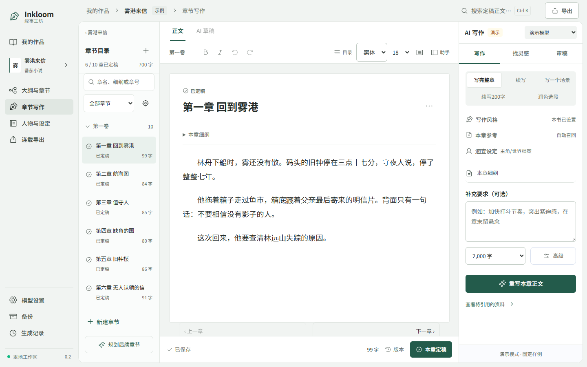

# Inkloom

面向中文长篇连载作者的本地 AI 写作工作台。从故事想法、全书规划到逐章写作、审阅定稿和稿件导出，在一个工作区内完成。AI 提供候选内容，作者决定采用什么。

**当前版本：0.2.0 · 本地测试版**



## 主要能力

- **规划故事**：生成全书方案、分卷与章节细纲，结合选定正文和人物档案讨论剧情。
- **辅助写作**：整章生成、续写、场景写作、找灵感、选段改写与审稿，支持设置作品文风。
- **管理长篇资料**：人物与关系、本章参考、定稿记忆、伏笔和故事脉络；修改前文后提示复核后续章节。
- **保留创作过程**：自动保存、版本历史、候选稿与冲突保护，采纳 AI 内容后保留旧版本。
- **交付稿件**：导入 TXT / Markdown，按章节范围导出 TXT、Markdown 或按章 TXT 压缩包，支持完整工作区备份与恢复。

## 快速开始

需要 **Node.js 22.12+、Python 3.13+ 和 uv**；Windows 还需 **PowerShell 7+**。

下载并解压源码，或克隆仓库：

```bash
git clone https://github.com/spark0v0/Inkloom.git
cd Inkloom
```

- **Windows**：双击根目录的 [Inkloom.cmd](Inkloom.cmd)，按 Enter 启动或打开工作台，输入 `S` 停止，`R` 重新构建并启动，`Q` 退出窗口。
- **macOS / Linux**：在项目根目录运行 `bash ./scripts/inkloom.sh`；未安装 PowerShell 时使用前台服务，按 `Ctrl+C` 停止。

首次启动会下载依赖并构建界面，需要网络连接。默认地址为 **http://127.0.0.1:8765**，实际地址以启动窗口为准。

启动后保留终端窗口；Windows 可在其中按 `Q` 或 `Ctrl+C` 停止，也可再次打开同一入口选择 `S`。停止前请确认正文已保存，正在进行的生成会被中断；更新代码前先停止服务。

## 开始创作

1. **连接模型**：在“模型设置”配置 Chat Completions 兼容服务、模型 ID 和密钥；本机无鉴权服务可留空密钥。
2. **新建作品**：填写故事想法、题材、目标平台与篇幅，生成并调整全书方案。
3. **规划章节**：按卷编写细纲，补充人物与设定，再进入章节写作。
4. **审阅与定稿**：通读生成候选后采纳，按需修稿；完成后点击“本章定稿”，核对记忆与原文依据，再进入下一章。
5. **导出连载**：选择章节范围，核对导出清单，下载稿件并自行上传番茄、起点等平台。

没有模型连接也能手写、保存、查看版本、导入导出与备份。内置演示模型提供固定样例，用于熟悉操作。详细步骤见 [试写指南](docs/START-WRITING.md)。

## 数据与使用说明

作品默认保存在项目的 `data/` 目录，建议定期通过“工作区备份”保存副本。备份不包含模型密钥，恢复后需重新配置。

使用云模型时，选定的小说上下文会发送到你配置的服务，费用由该服务收取。AI 输出需要作者审阅；长篇连续创作效果仍待验证，建议先用少量章节试写。

## 开发与文档

技术栈：React + TypeScript + Vite + Tiptap，FastAPI + SQLAlchemy + SQLite。

```powershell
pwsh -File ./scripts/dev.ps1   # 开发模式
pwsh -File ./scripts/test.ps1  # 工程检查
```

[产品说明](docs/PRODUCT.md) · [技术架构](docs/ARCHITECTURE.md) · [开发约定](AGENTS.md) · [工程收尾与使用边界](docs/PROJECT-CLOSEOUT-2026-11-08.md)
