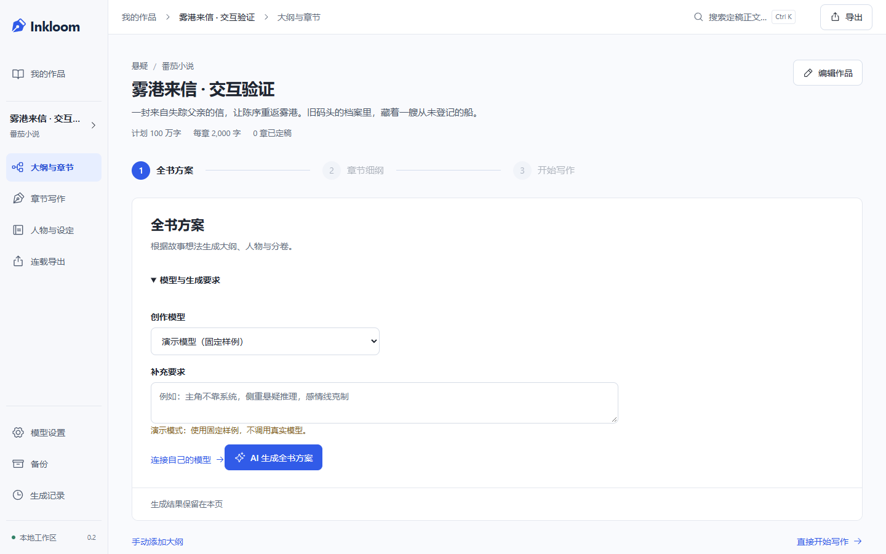
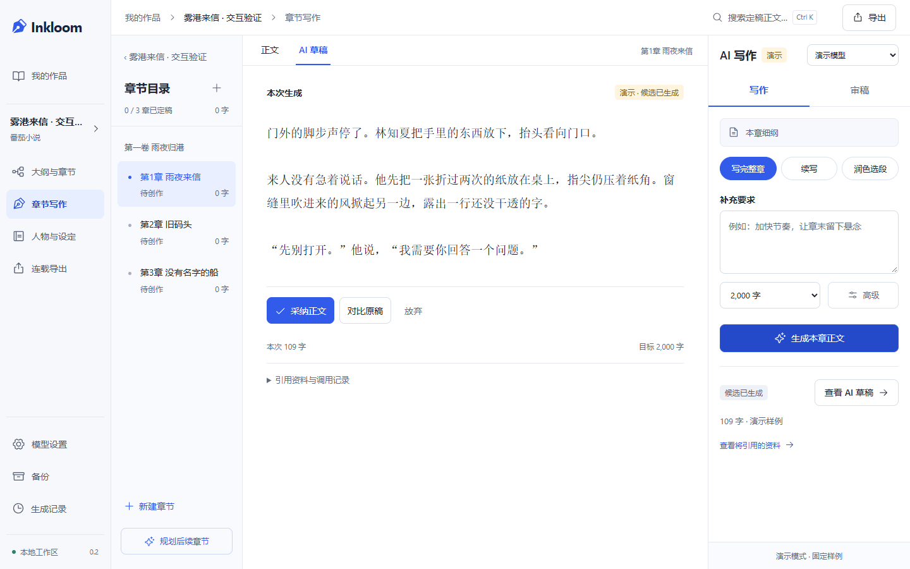

# Inkloom

从一个故事想法，走到可以持续连载的长篇小说。

Inkloom 是中文 AI 小说创作工作台。接入自己的大模型，让 AI 策划全书、设计人物与世界、规划分卷和章节、生成整章正文、审稿并整理记忆。作者负责选择方向和确认稿件，已有正文始终保留版本。

**当前版本：0.2.0 本地测试版。** 源码：[spark0v0/Inkloom](https://github.com/spark0v0/Inkloom)。实际能力见 [0.2 实现记录](docs/IMPLEMENTATION-V0.2.md)，最新交互修订与验证见 [V4 记录](docs/IMPLEMENTATION-UX-V4.md)。

最新改进：[长篇目录与参考资料](docs/IMPLEMENTATION-LONGFORM.md)。支持目录搜索、分卷折叠、状态筛选和前后切章；AI 按本章细纲与人物别名召回相关资料，修复较早设定被遗漏的问题。

模型接入改进：检查连接后可从服务目录选择模型，错误在对应连接旁显示；读取模型响应时执行大小限制。详见 [本轮代码审查、调研与后续优先级](docs/REVIEW-2026-10-23.md)。

写作卡住时，在写作助手点 **找灵感**，选择卡点，获取三个剧情走向；可展开人物动机、选择、代价、铺垫和前文依据。选中方向后，再点 **按此方向续写** 生成候选正文。灵感与正文分开保存，原稿修改后旧方向不可直接用于续写。详见 [实现与验证记录](docs/IMPLEMENTATION-INSPIRATION.md)。

## 开始创作

1. **连接模型**：在“模型设置”填写服务地址、模型 ID 和 API Key；首次保存可同时设为策划、写作、记忆与审稿的默认模型。
2. **AI 开书**：新建小说，填写想法、题材、目标平台、全书篇幅和每章字数。书名可以稍后由 AI 起名。
3. **规划与写作**：在页面内生成全书方案，采纳后直接进入章节细纲；确认章节后点击开始写作。桌面可在中央 AI 草稿页签通读和采纳，支持续写、选段润色与审稿。
4. **定稿与连载**：采纳正文后，在“本章定稿”中整理带原文依据的记忆，确认后进入下一章。支持整本 TXT、Markdown，以及每章一个 TXT 的 ZIP 压缩包。

番茄小说、起点中文网和自由创作是可编辑的创作目标。导出稿件由作者自行上传；不自动发布到平台。目标字数属于计划，界面显示实际生成字数。

没有 API Key 时仍能手写、自动保存、查看版本、导入导出与备份。演示模型是明确标注的固定本地样例；不代表真实 AI 的文学效果。

## 实际界面

以下是应用运行截图，先生成的 UI 概念图与完整提示词在 [设计记录](docs/design/IMPLEMENTATION-V4.md)。





## 本地运行

Windows 使用 PowerShell 7，需要 Node.js 22.12+、Python 3.13+ 和 uv。

```powershell
pwsh -File .\scripts\setup.ps1
pwsh -File .\scripts\start.ps1
```

打开 **http://127.0.0.1:8765**。已有依赖时用 `start.ps1 -Build` 更新前端并启动。作品保存在 `data/`，不要删除该目录来解决启动问题。

```powershell
pwsh -File .\scripts\dev.ps1           # 前后端开发
pwsh -File .\scripts\test.ps1          # 静态检查、后端测试、接口契约、前端测试与构建
pwsh -File .\scripts\test.ps1 -Browser # 加上 Chrome 桌面与手机流程
pwsh -File .\scripts\start.ps1 -Port 8766 -DataDirectory D:\StoryWorkspace
```

测试使用独立的 `.tmp/` 工作区。技术栈为 React、TypeScript、Vite、Tiptap、FastAPI 和 SQLite；精确依赖版本见锁文件。API 类型由后端 OpenAPI 生成。

## 模型与数据

支持 Chat Completions 兼容接口。请按所用服务的实际能力填写上下文容量、输出上限、流式、JSON mode 等选项。写长章时应为模型保留足够的输出上限；遇到截断会保留片段，不能直接当作完整稿采纳。

密钥仅交给本机后端，Windows 使用 DPAPI 加密保管，不读回前端，不随备份导出。**选中的小说上下文会发送到配置的模型服务。** 费用缺少价格或 usage 时显示未知；生成中断且上游状态未知时，不自动重发付费请求。

正文、候选稿、规划和记忆分别保存。旧稿修改后，相关记忆与候选会失效；定稿会检查章节顺序与原文版本。备份使用一致性快照，恢复先校验到新目录，保留原工作区；0.1.0 工作区及备份支持升级。

## 开发文档

- [当前实现、验证和限制](docs/IMPLEMENTATION-V0.2.md)
- [项目规范 AGENTS.md](AGENTS.md)
- [产品方案](docs/PRODUCT.md) / [技术方案](docs/ARCHITECTURE.md) / [路线](docs/ROADMAP.md)
- [新版工作流与调研取舍](docs/decisions/0004-serial-production.md)
- [新版 UI、概念图与真实截图](docs/design/IMPLEMENTATION-V4.md)
- [最初的开源与论坛调研](docs/RESEARCH.md)
- [新增热门项目调研与长篇改进取舍](docs/decisions/0006-longform-navigation-context.md)
- [模型接入审查、开源反馈与后续优先级](docs/REVIEW-2026-10-23.md)
- [开发启动提示词](START_PROMPT.md) / [运行时提示词](prompts/)

真实云模型的长篇质量、完整 Windows 输入法人工体验、跨浏览器与百万字性能仍待独立验证。当前不提供云同步、多人协作或完整剧情分支。项目独立实现，运行数据和密钥不进入源码仓库。
