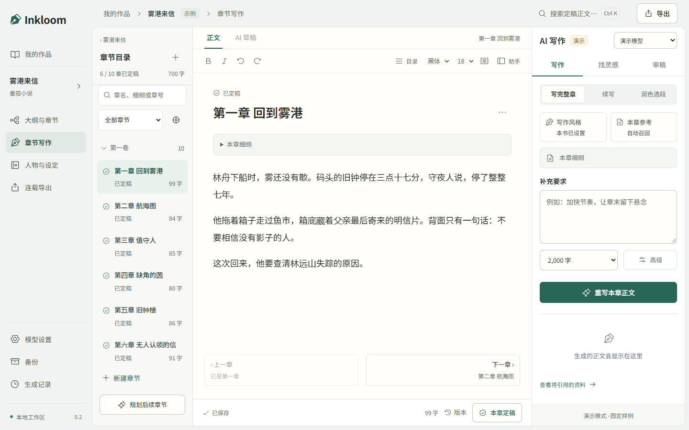
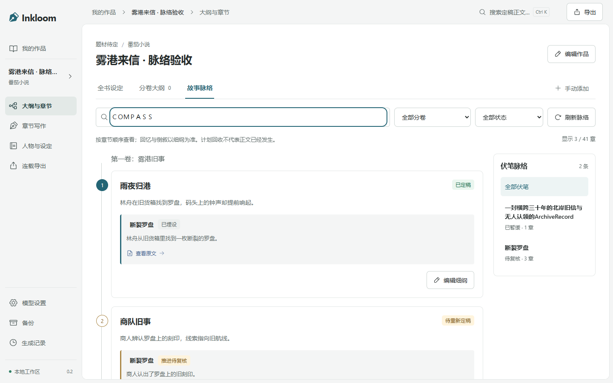
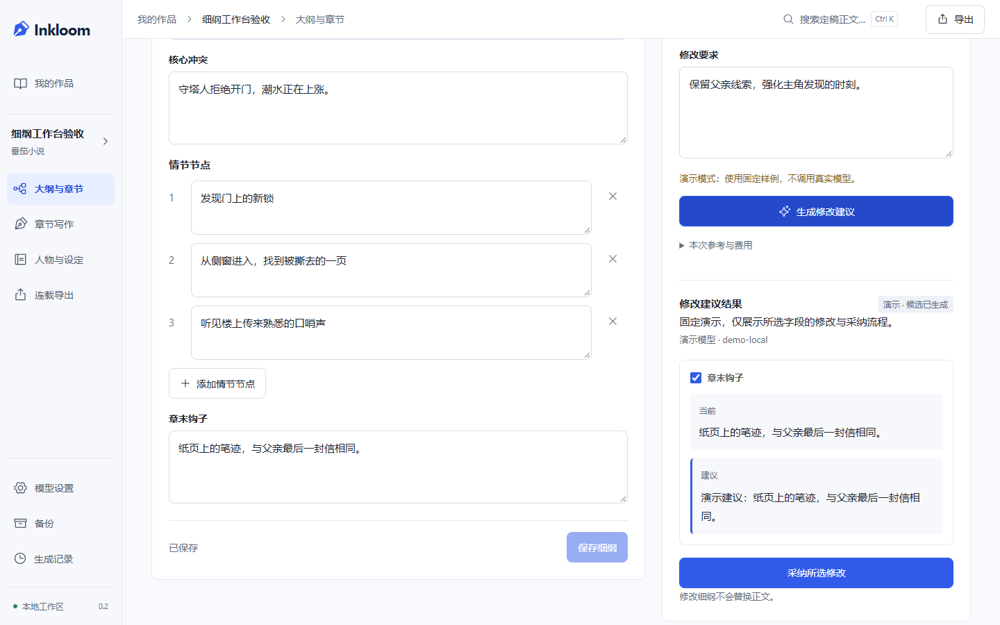
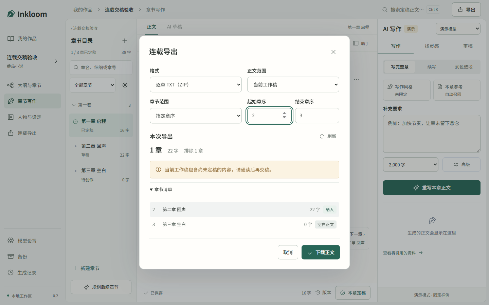

# Inkloom

面向中文长篇连载的 AI 小说创作工作台。接入自己的模型，从故事想法开始，规划全书、生成章节、审稿修稿、整理记忆，最后导出稿件。作者决定采用什么，已有正文保留版本。

**当前为 0.2.0 本地测试版。** 支持面向番茄、起点等平台的创作目标和稿件导出，发布由作者自行完成。真实长篇成稿质量与费用仍待评测；演示模型只用于体验固定流程。

[本地启动](#本地运行) · [三章试写指南](docs/START-WRITING.md) · [前端工程复查](docs/REVIEW-FRONTEND-2026-11-01.md) · [流程与安全复查](docs/REVIEW-2026-11-01.md) · [当前限制](#当前限制)

2026-11-01 继续基于实际代码复查：补齐正文与档案讨论、轻量场景写作及改稿复核清单的验证，修复草拟被前章定稿阻塞、关系上下文预算、短选段改写、备份引用与连接凭证边界。新增关系编辑并发保护及手机/键盘操作，具体证据见 [本次复查](docs/REVIEW-2026-11-01.md)。真实模型连续创作、费用与文学效果仍未验收。

随后完成[前端保存边界优化](docs/REVIEW-FRONTEND-2026-11-01.md)：档案冲突保留本页修改并接入其他字段的新内容，默认模型切换串行保存；新建、导入与连接配置在等待回执期间锁定参数，导入读取失败不再残留旧稿。

## 可以做什么

| 创作环节 | 当前能力 |
| --- | --- |
| 开书与规划 | AI 全书方案、按卷分批细纲、手动编辑与版本历史；规划讨论可明确选择最多三章细纲、三章已保存正文和十二条作者档案 |
| 章节写作 | 整章生成、续写、约 200 字短续写、轻量场景写作；先审阅候选，采纳后生成正文新版本 |
| 卡剧情与修稿 | 比较三个剧情方向，再按选定方向续写；选段润色、扩写、缩写及动作、感官、对白等要求；按单条审稿意见准备段落改写 |
| 长篇资料 | 本章必读、作品文风、带原文依据的记忆、作者人物关系、伏笔跟进与故事脉络；自动资料受范围和上下文预算限制 |
| 改稿与复核 | 修改已定稿前文后保守标记后章待复核；清单按章定位，正文比较按需加载，明确参考变化要求重新选择 |
| 模型接入 | Chat Completions 兼容连接、服务配置起点与模型目录检查；本机无鉴权兼容服务可留空密钥，云服务仍须配置凭证 |
| 保存与交付 | 自动保存、浏览器恢复副本、冲突保护、不可变版本和中断片段；按章序预览导出 TXT/Markdown/按章 TXT ZIP，备份到新目录校验恢复 |

人物与关系属于作者设定，不能保证模型不写错。自动召回并非完整语义理解，缺少依据时保持未知。场景写作只把要求绑定到一次续写候选；没有独立场景目录、场景版本或自动节拍循环。短续写追加到正文末尾。

## 开始创作

可以先按 [三章试写指南](docs/START-WRITING.md) 完成一部作品的开头，再根据通读、返工和实际费用判断是否继续扩大。

1. **连接模型**：在“模型设置”选择服务或手动填写地址，核对模型 ID、容量与协议能力，再配置该服务的 API Key。本机无鉴权服务可留空；价格默认未知，核对来源后可手动填写。首次保存可同时设为各任务的默认模型。
2. **AI 开书**：新建小说，填写想法、题材、目标平台、全书篇幅和每章字数。书名可以稍后由 AI 起名。
3. **规划与设定**：在页面内生成全书方案，在“人物与设定”中录入角色并使用“关系图谱”绘制全书人物羁绊网；采纳后直接进入章节细纲。
4. **章节写作**：确认章节后点击开始写作。桌面可在中央 AI 草稿页签通读和采纳，支持整章生成、轻量场景写作、续写、选段润色、审稿与“找灵感”。前章尚未定稿时可以继续草拟，但自动上下文不引用未定稿或待复核前文。
5. **定稿与连载**：采纳正文后，在“本章定稿”中整理带原文依据的记忆，确认后进入下一章。再次打开会恢复当前版本已确认的记忆；提示定稿结果未确认时，使用“确认上次定稿”核实原请求。导出时可选择章序范围，检查纳入清单，再下载 TXT、Markdown 或每章一个 TXT 的 ZIP 压缩包。

番茄小说、起点中文网和自由创作是可编辑的创作目标。导出稿件由作者自行上传；不自动发布到平台。目标字数属于计划，界面显示实际生成字数。

没有 API Key 时仍能手写、自动保存、查看版本、导入导出与备份。演示模型是明确标注的固定本地样例；不代表真实 AI 的文学效果。

## 实际界面

以下为实际运行截图，内容使用虚构测试材料。工作台与故事脉络的概念图、提示词和实现分别见 [工作台设计](docs/design/IMPLEMENTATION-UI-POLISH-2026-10-29.md) / [脉络设计](docs/design/UI-STORY-MAP-2026-10-30-PROMPT.md)。










## 本地运行

Windows 使用 PowerShell 7，需要 Node.js 22.12+、Python 3.13+ 和 uv。

- **一键启动**：双击根目录的 [`启动 Inkloom.cmd`](启动%20Inkloom.cmd)（macOS / Linux 下运行 [`启动 Inkloom.sh`](启动%20Inkloom.sh)）。首次自动准备项目依赖并构建网页，服务就绪后打开默认浏览器；若服务已在运行，控制台提供打开网页或快捷停止选项。默认端口被占用时自动在 8765—8774 中挑选空闲端口。
- **一键关闭**：双击根目录的 [`关闭 Inkloom.cmd`](关闭%20Inkloom.cmd)（macOS / Linux 下运行 [`关闭 Inkloom.sh`](关闭%20Inkloom.sh)），一键安全关闭正在运行的 Inkloom 后台服务并释放端口与锁；也可在原启动控制台窗口直接按 `Ctrl+C` 停止服务。缺少系统工具时按窗口提示安装后重试。[启动验收记录](docs/verification/2026-10-25-launcher.txt)。

也可在 PowerShell 中运行以下命令；`-Port` 指定新服务的端口（同一工作区已运行时仍复用原地址），`-NoBrowser` 禁用自动打开网页，`-Rebuild` 强制重新构建（先停止已运行的服务）：

```powershell
pwsh -File .\scripts\launch.ps1
pwsh -File .\scripts\launch.ps1 -Port 8766 -NoBrowser -DataDirectory D:\StoryWorkspace
```

原有分步安装与启动入口仍可使用：

```powershell
pwsh -File .\scripts\setup.ps1
pwsh -File .\scripts\start.ps1
```

打开 **http://127.0.0.1:8765**。已有依赖时用 `start.ps1 -Build` 更新前端并启动。作品保存在 `data/`，不要删除该目录来解决启动问题。

```powershell
pwsh -File .\scripts\dev.ps1           # 前后端开发
pwsh -File .\scripts\test.ps1          # 静态检查、后端测试、接口契约、前端测试与构建
pwsh -File .\scripts\test.ps1 -Browser # 加上 Chrome 桌面与手机流程
pwsh -File .\scripts\start.ps1 -Port 8766 -DataDirectory D:\StoryWorkspace
```

测试使用独立的 `.tmp/` 工作区。技术栈为 React、TypeScript、Vite、Tiptap、FastAPI 和 SQLite；精确依赖版本见锁文件。API 类型由后端 OpenAPI 生成。

## 模型与数据

支持 Chat Completions 兼容接口。请按所用服务的实际能力填写上下文容量、输出上限、流式、JSON mode 等选项。写长章时应为模型保留足够的输出上限；遇到截断会保留片段，不能直接当作完整稿采纳。

密钥仅交给本机后端，Windows 使用 DPAPI 加密保管，不读回前端，不随备份导出。**选中的小说上下文会发送到配置的模型服务。** 费用缺少价格或 usage 时显示未知；生成中断且上游状态未知时，不自动重发付费请求。

模型请求默认最长 15 分钟；连续 3 分钟没有有效正文输出时停止等待，已有片段仍保留。另有网络阶段超时和响应大小限制。慢模型可在启动前调整 `INKLOOM_REQUEST_TIMEOUT_SECONDS`、`INKLOOM_PROGRESS_TIMEOUT_SECONDS`，取值 1—3600 秒；新任务会记录本次时限，详见 [配置说明](docs/IMPLEMENTATION-CONTEXT-BOUNDARIES.md#模型时限)。

正文、候选稿、规划和记忆分别保存。旧稿修改后，相关记忆与候选会失效；定稿会检查章节顺序与原文版本。备份使用一致性快照，恢复先校验到新目录，保留原工作区；0.1.0 工作区及备份支持升级。

## 当前限制

- 以作者审阅、逐章定稿推进。复核清单采用保守的后章失效判断，只列稿件变化及明确的必读前文依赖；不是语义影响分析，不会自动确认后章。
- 中文资料召回使用有范围与预算限制的词法检索；不是完整的语义记忆系统，也不能保证自动发现全部剧情矛盾。
- 规划讨论只直接读取显式选中的正文与档案；历史讨论仍可能含先前资料的引文。场景写作复用章节候选，没有独立场景数据模型、多章自动改纲、云同步或多人协作。
- 真实模型连续十章的成稿、人物一致性、返工量和费用，以及百万字性能、完整 Windows 输入法人工体验与跨浏览器表现，仍待独立验证。

## 开发文档

- [2026-11-01 产品流程、代码与安全复查](docs/REVIEW-2026-11-01.md) / [三项创作辅助能力](docs/IMPLEMENTATION-AUTHORING-ASSISTANCE.md)

- [写作微操作与非阻塞草拟：实际范围 (ADR 0025)](docs/decisions/0025-author-centric-craft-and-brainstorm.md)
- [实体关系表、图谱可视化与上下文关系注入 (ADR 0024)](docs/decisions/0024-entity-relationships-graph.md)
- [规划讨论、资料范围、历史读取与迁移](docs/IMPLEMENTATION-PLANNING-DISCUSSIONS.md)
- [结项交付、最终竞品对照与实际验证](docs/PROJECT-CLOSEOUT-2026-10-31.md)
- [当前实现、验证和限制](docs/IMPLEMENTATION-V0.2.md)
- [最新竞品对照、主流程 review 与修复](docs/REVIEW-2026-10-31.md) / [此前工程修复与配置](docs/IMPLEMENTATION-CONTEXT-BOUNDARIES.md)
- [项目规范 AGENTS.md](AGENTS.md)
- [产品方案](docs/PRODUCT.md) / [技术方案](docs/ARCHITECTURE.md) / [路线](docs/ROADMAP.md)
- [新版工作流与调研取舍](docs/decisions/0004-serial-production.md)
- [新版 UI、概念图与真实截图](docs/design/IMPLEMENTATION-V4.md)
- [最初的开源与论坛调研](docs/RESEARCH.md)
- [新增热门项目调研与长篇改进取舍](docs/decisions/0006-longform-navigation-context.md)
- [模型接入审查、开源反馈与后续优先级](docs/REVIEW-2026-10-23.md)
- [本章必读参考、重试恢复与验证](docs/IMPLEMENTATION-REFERENCES.md) / [连续性工程评测](evals/README.md)
- [审稿修稿、完整生成历史与验证](docs/IMPLEMENTATION-REVIEW-REVISION.md) / [热门项目对照与剩余缺口](docs/REVIEW-2026-10-25.md)
- [伏笔计划、正文进展与验证](docs/IMPLEMENTATION-THREAD-TRACKING.md)
- [作品写作风格、选段快捷操作与验证](docs/IMPLEMENTATION-WRITING-ASSISTANCE.md) / [开源交互对照](docs/REVIEW-2026-10-27.md)
- [生成进度读取优化、断线补偿与验证](docs/IMPLEMENTATION-LIVE-PROGRESS.md)
- [章节细纲编辑、历史恢复与 AI 局部修改](docs/IMPLEMENTATION-CHAPTER-OUTLINES.md)
- [故事脉络、伏笔依据与截图](docs/IMPLEMENTATION-STORY-MAP.md)
- [编辑入口并发、迟到回执修复与开源实现对照](docs/REVIEW-2026-10-28.md)
- [多窗口恢复副本、原始基线与作品设置保护](docs/IMPLEMENTATION-RECOVERY-BOUNDARIES.md)
- [工作台 UI 优化、概念图与浏览器截图](docs/design/IMPLEMENTATION-UI-POLISH-2026-10-29.md)
- [大纲、人物与模型设置的长内容和手机界面优化](docs/design/IMPLEMENTATION-UI-DETAIL-2026-10-30.md)
- [配色、本地中文字体和阅读偏好](docs/design/IMPLEMENTATION-TYPOGRAPHY-2026-10-31.md)
- [开发启动提示词](START_PROMPT.md) / [运行时提示词](prompts/)

技术栈为 React + TypeScript + Vite + Tiptap、FastAPI + SQLAlchemy + SQLite。项目独立实现，运行数据和密钥不进入源码仓库。
