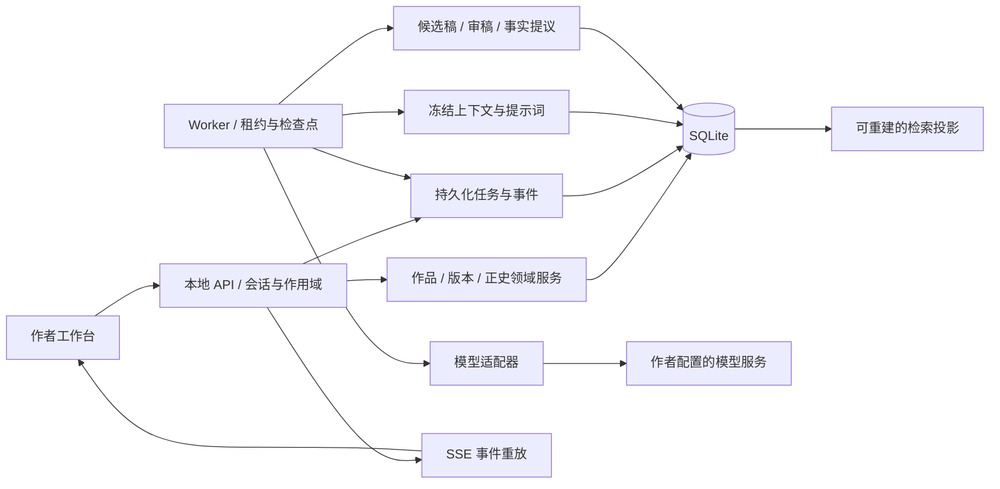
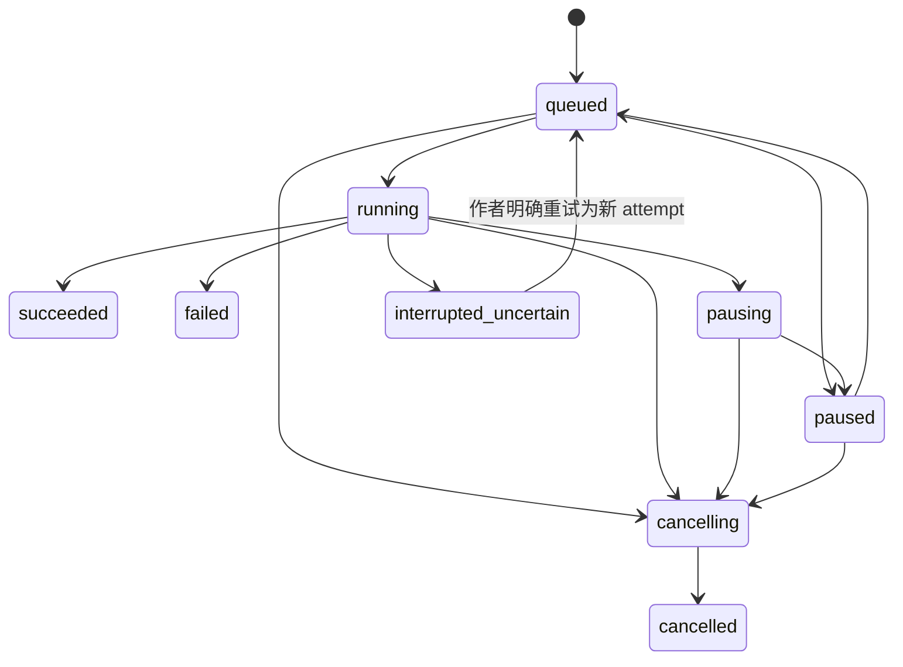

# 技术方案与关键契约

> 当前 0.2 沿用模块化单体和 SQLite，在已有生成任务中增加全书方案、分卷章节细纲及事务采纳；该阶段迁移为 `a12c7e604bc9`，本章参考迁移为 `b73d2f809a61`，最新伏笔跟进迁移为 `c84e3a190b72`。实际变更见 [连载工作流决策](decisions/0004-serial-production.md)、[0.2 实现记录](IMPLEMENTATION-V0.2.md)、[本章参考实现](IMPLEMENTATION-REFERENCES.md) 与 [伏笔跟进实现](IMPLEMENTATION-THREAD-TRACKING.md)，以下保留最初的完整技术方案。

2026-10-24 增加结构化 `inspiration` 任务与选中方向引用，复用任务表，无数据库迁移。方向在服务端按同作品、同章节与上下文基线校验；列表查询按章节过滤且不加载冻结上下文。前端结果展示与 SSE Hook 从写作助手拆出，供编辑器、任务记录和规划页复用。契约见 [决策 0007](decisions/0007-in-chapter-inspiration.md)。

2026-10-25 完成本章参考：`references.py` 负责选择修订、同书/前文章序/定稿版本校验和恢复校验，`context.py` 冻结必读与非正史材料；HTTP 层只转交契约。`ContextInput.references_revision` 为可选兼容字段，新前端始终发送，拒绝旧窗口继续生成。参考变更和迟到任务完成均检查基线；必读不参与可选裁剪。`AttemptHistory` 由助手与任务记录复用，历史片段只读下载。恢复兼容两份旧迁移和当前迁移，校验后在新目录升级。详见 [决策 0008](decisions/0008-chapter-references.md)。

同日新增审稿修稿与历史分页，无新迁移：`review_rewrite.py` 从有效审稿的指定意见解析真实版本和稳定段落 ID，准备只读；`ContextInput.review_reference` 冻结来源哈希，完成与采纳同时检查意见、作者判断、依据和整段选区。`FindingDecision` 的可选基线字段保护新客户端的并发说明。`job_history.py` 提供绑定筛选作用域的 `(created_at, id)` 游标分页，SQL 只选有限摘要；原 `/jobs` 接口保留 150 条及旧响应供兼容入口使用。`ReviewFindings` 与 `SourceButton` 供编辑器和历史详情复用。契约见 [决策 0009](decisions/0009-review-rewrite-history.md)，验证见 [实现记录](IMPLEMENTATION-REVIEW-REVISION.md)。

状态：**规划基线，已有 0.1.0 本地实现**。以下细分目录和部分字段仍是可演进设计，实际结构与取舍见 [ADR 0001](adr/0001-local-workspace.md)，验证范围见 [IMPLEMENTATION.md](IMPLEMENTATION.md)。技术调整不能绕开数据安全和作者控制原则。

2026-10-26 新增 `ThreadTrack`、`ThreadProgress`，沿用伏笔 Entity，不把计划当事实。`threads.py` 按章序、段序计算有效进展，负责跟进修订、幂等新增、撤销与恢复；`context.py` 仅冻结当前章之前的进展，并把原文列为不可静默裁剪的依据。计划和关联变更递增作品设置修订，沿用旧任务失效机制。`thread_restore.py` 独立核验备份中的归属和不可变引文；旧上下文的 `thread_guidance` 缺失时默认为空。恢复支持前三个旧迁移，先验证再在新目录升级，未提供向旧代码直接降级承诺。契约见 [决策 0010](decisions/0010-thread-tracking.md)。

## 架构选择

选择“网页工作台 + 本地 API + 持久化 worker”的模块化单体。初版不要求 Docker、PostgreSQL、向量服务或 WSL 才能写作。

| 层 | 推荐组合 | 原因与边界 |
| --- | --- | --- |
| 前端 | React、TypeScript strict、Vite | 以编辑交互为核心，暂不需要 SSR 与营销 SEO；静态资源可由后端同源提供 |
| 编辑器 | Tiptap 开源核心 | 支持结构化段落、选区与扩展；先做中文输入法验证，不引入不必要的付费协作能力 |
| UI | Tailwind、基于 Radix 的可访问性组件、统一 Phosphor 图标 | 采用设计 token 定制，避免直接交付默认组件皮肤 |
| 数据状态 | TanStack Query；少量 Zustand | 服务状态与临时 UI 状态分开，编辑缓冲不随查询刷新被替换 |
| 后端 | FastAPI、Pydantic、SQLAlchemy、Alembic | 领域服务与传输分离，适合结构化生成、校验与本地工具 |
| 存储 | SQLite WAL、FTS5、工作区文件目录 | 单用户初版部署简单；短事务、有限并发，不能宣传为无限多人服务 |
| 任务 | 同库持久化 Job、事件、租约；独立 worker 入口 | 不把长生成仅放在 HTTP 请求或内存任务中 |
| 检查 | Ruff、Python 类型检查、pytest；前端类型检查、Vitest、关键 Playwright 流程 | 以数据边界和用户行为为重点，具体脚本在落地时建立 |

实际版本应在开发时查官方兼容说明并写锁文件。此方案不预填可能过时的精确版本号。初版不创建“同时兼容所有数据库”的抽象；确有多人需求时再迁移 PostgreSQL 并重新验证事务、并发与备份。



FastAPI 的 [BackgroundTasks 文档](https://fastapi.tiangolo.com/tutorial/background-tasks/)介绍的是响应后的后台任务机制，不提供本方案要求的持久化恢复契约。本项目自行持久化任务，而不是因为使用了某个框架就声称可恢复。

## 建议目录与模块责任

```text
frontend/
  src/app/                 路由、布局与本地会话
  src/features/library/    作品与导入
  src/features/editor/     编辑缓冲、保存与候选比较
  src/features/bible/      档案、原文依据与事实确认
  src/features/planning/   简报、卷章与场景目标
  src/features/jobs/       事件、部分稿与错误恢复
  src/features/settings/   Provider 与工作区设置
  src/shared/              UI token、契约客户端与通用组件
backend/
  app/api/                 HTTP/SSE、鉴权与错误映射
  app/domain/              作品、版本、正史与状态规则
  app/application/         保存、采纳、确认、失效和备份用例
  app/generation/          固定阶段、预算与上下文组装
  app/providers/           transport 与能力适配
  app/retrieval/           别名、全文索引与有效来源筛选
  app/jobs/                领取、租约、检查点、事件与取消
  app/storage/             ORM、数据库、迁移与安全文件路径
  tests/
prompts/                   运行时模板、版本与输出 Schema
evals/                     自创或获授权样例、标签与评测脚本
scripts/                   启动、检查和开发辅助入口
docs/                      已有方案、设计与后续 ADR
```

工作区运行时目录使用明确配置路径，开发默认可为被忽略的 `data/`：数据库、附件和产物在内，凭证单独存储。前端不直接读写文件，Provider 不直接改领域表，API 路由不承载提示词编排。

## 核心实体与不变量

| 实体 | 关键字段 | 不变量 |
| --- | --- | --- |
| Novel | `id`, `title`, `language`, `settings_revision`, `canon_revision`, `dirty_from_order` | 每次读取明确作品作用域 |
| Chapter | `id`, `novel_id`, `order_key`, `working_version_id`, `accepted_version_id`, `review_state` | 工作稿与已确认版本可以不同；顺序不依赖标题 |
| ManuscriptVersion | `id`, `chapter_id`, `parent_id`, `editor_doc`, `plain_text`, `content_hash`, `created_at` | 不可变；恢复旧稿也创建新版本 |
| Paragraph | `paragraph_id`, `version_id`, `text`, `ordinal` | 来源始终同时带段落 ID 和版本 |
| Candidate | `id`, `base_version_id`, `selection`, `context_snapshot_id`, `status`, `partial_artifact_id` | 流式区域独立；`partial` 不能作为完整候选自动采纳 |
| CanonRevision | `id`, `novel_id`, `parent_revision`, `accepted_mapping`, `confirmed_by`, `recorded_at` | 不可变地记录确认范围，保留旧修订历史 |
| Entity / EntityAlias | `novel_id`, `entity_id`, `kind`, `name`, `alias` | 同名跨书不合并；别名归并由作者确认 |
| CanonFact | `novel_id`, `revision`, `subject`, `predicate`, `value`, `story_time`, `disclosure_order`, `evidence`, `authority` | 计划不是事实；未知值不补猜；证据检查不等于语义一定正确 |
| KnowledgeRecord | `character_id`, `fact_id`, `learned_at`, `evidence` | 世界事实不自动成为所有人物的知识 |
| PlotThread | `id`, `novel_id`, `state`, `introduced_at`, `resolution_evidence` | 回收必须有依据，作者有意留白单独记录 |
| ContextSnapshot | `id`, `novel_id`, `canon_revision`, `source_versions`, `prompt_versions`, `model_config_revision`, `budget` | 内容冻结、无密钥；来源哈希可核对 |
| ReviewFinding | `target_version`, `type`, `target_span`, `source_evidence`, `author_decision` | 审稿与豁免绑定版本，不能跨稿无限继承 |
| GenerationJob / Attempt | `id`, `task`, `state`, `attempt`, `lease_owner`, `lease_epoch`, `checkpoint` | 受限重试和可审计状态迁移 |
| JobEvent / LLMCall | `job_id`, `seq`, `call_state`, `usage`, `price_revision`, `error_code` | 事件有序可重放；usage 缺失保留 null |

P0 可预留 `branch_id = main` 并强制校验，但不交付完整替代剧情分支。未来分支必须连同正史、检索和任务作用域一起隔离，不能只在 UI 上加一列分支名。

固定设定以有版本的作者条目保存；正文中发生的状态变化以事件/事实记录。规则冲突不能简单“最新摘要覆盖一切”，要显示来源和冲突，由作者选择。

### 段落引用契约

以下为设计示例，不是已运行的响应：

```json
{
  "novel_id": "novel_example",
  "chapter_id": "chapter_06",
  "version_id": "version_12",
  "paragraph_id": "paragraph_a1",
  "start_codepoint": 0,
  "end_codepoint": 9,
  "quote": "他把信封翻了过来。",
  "content_hash": "sha256-of-canonical-source"
}
```

- 范围采用 Unicode code point 的 `[start, end)`，不能混用 JavaScript UTF-16 索引与 Python 字符索引。切分与跨语言转换须有包含 emoji、换行和组合字符的共享样例。
- 校验作品、版本、段落、哈希、范围与 `quote` 一致；不匹配的记忆或审稿引用不能成为有效事实。
- 稳定 ID 服务于同一逻辑段落的跟踪；拆分/合并生成新 ID 并保留来源关系。旧引用继续指向旧版本，不能静默漂移到新文本。
- `content_hash` 对约定的 UTF-8、统一换行的原文计算；不能先做破坏语义的简繁转换或去标点。检索归一化另做投影，原文保留。
- 确定性引用校验只证明引用存在，不能证明模型推论成立。语义采用仍需作者确认，评测也要单独测“引用存在”和“引用支持结论”。

## 保存与候选采纳

浏览器编辑缓冲、恢复缓存、持久化正文版本是三个层次。

1. 输入时更新本地缓冲；组合输入过程中不提交重建编辑器内容，不抢占光标。恢复缓存可节流写 IndexedDB，按工作区、作品、章节与基线隔离。
2. 约 800ms 空闲后保存；显式保存与离开章节也发起保存。写入频率应通过测量调整，不能依赖页面关闭时的最后一次请求保证数据安全。
3. 请求携带 `base_version_id` 和操作幂等键；服务端在短事务中比较当前指针、插入版本并更新指针，确认后 UI 才显示“已保存”。
4. 版本已变化返回 `409 VERSION_CONFLICT`，保留本地文本与远端文本。自动保存序列化，防止较慢旧请求覆盖较快新请求。
5. 采纳使用独立事务，再次检查 `base_version_id`、选区文本哈希、正史/设定依赖与候选状态；同一候选重复采纳返回同一结果。
6. 基线不同或上下文过期时显示比较，不自动替作者合并。P0 可采用人工选择文本并重新保存的安全重建基线流程；原候选保留。

选段采纳默认只替换指定范围，不能重新生成整章后覆盖未选文字。被取消的任务、旧租约 worker 和无效来源不能调用采纳事务。

## 正史提交与失效

正史是“作者确认的章节版本和事实集合”，不是每次保存自动拼接的摘要。

1. 为固定正文版本准备事实候选和差异，AI 提取或人工填写均可。提取任务不具备提交正史权限。
2. 作者审阅并选择条目；确认时校验正文仍为目标版本、来源有效、作用域正确。
3. 在同一事务中创建新正史修订、更新章节确认指针、提交选中的事实/知识/伏笔、标记依赖失效并记录事件。
4. 空事实集合可提交，但显式保留“未整理”状态；检索仍可查询已确认原文，不把缺少结构化条目解释成没有发生。
5. 保存已确认章节的新工作稿时设置 `dirty_from_order`。默认生成不能使用该位置及之后的旧投影作为当前事实，历史视图仍可查看旧正史修订。
6. P0 从脏位置起保守失效，包括后续章节摘要、事实、审稿和上下文；后续既有正文保留，标记待复核。
7. 重新确认修订章节后重建可信前缀；后缀逐章复核并确认。恢复旧正史作为新工作稿可取消修订，但不能删除实验版本。

确认指针与失效标记必须同步落库。重建索引时可后台处理，但不能在“索引重建中”继续读旧条目。生成预检查遇到必需范围未就绪时返回 `CANON_DIRTY` 或 `MEMORY_REBUILDING`，手工编辑不受阻。

P1 才根据精细依赖图缩小失效范围。无依赖证据时不能自行认定下游不受影响。

## 上下文与中文检索

上下文按任务构造，并保存可读清单：

1. **保护层：** 系统边界、作者硬约束、本次任务、当前章基线/选区、相关已确认规则与关键事实。
2. **连续性层：** 前一章交接、近期有效摘要、相关人物状态、角色获知信息与当前场景目标。
3. **证据层：** 同作品/有效修订内的原文片段与资料库引用，保留顺序和来源。
4. **可选层：** 额外文风示例、较远章节、次要计划和可裁剪参考。

计划可以供规划器参考；其未来事件必须标为 `planned`，不能混成写作时已经发生的事实。角色视角约束与叙述者的作者资料分开，必要秘密不进入角色知识包。

预算包括指令、Schema、资料、输出额度与安全余量。保护层超预算应停止并解释，不静默截断。模型上下文容量或 tokenizer 未知时用明确的保守估算并标识，不假装得到精确 token 数。

### P0 检索路径

- 先做作品与有效来源过滤，再做实体/别名精确匹配与关系扩展；作用域不能只靠提示词约束。
- 正文与资料按稳定段落切块，P0 使用 FTS5 trigram/BM25 候选和实体匹配，排序结合任务与来源新旧。
- SQLite [FTS5 trigram 文档](https://www.sqlite.org/fts5.html#the_trigram_tokenizer)明确：少于三个 Unicode 字符的全文查询不能命中。因此“两字中文名”走别名表/精确匹配，短通用词走限定作品和范围的字面匹配回退，不能只写 `MATCH` 就宣称中文可用。
- 原始检索输入参数化，FTS 查询语法另行转义；禁止把模型生成的 SQL 或过滤表达式直接执行。
- 索引只引用当前有效来源；重写时旧块失效/替换，不无限累积。检索片段按原文顺序组合并去重，显示未命中与截取范围。
- 初版索引为可重建投影。可选 embedding 只有在同一中文评测集表现确实更好时引入；记录 embedding 模型/维度/版本，缺失时回退全文检索。

不声称 RAG 可以消除幻觉；它只改善可用证据，仍需要审稿、作者选择与实际评测。

## 任务、恢复与取消

### 状态与产物分开

Job 状态：`queued`、`running`、`pausing`、`paused`、`cancelling`、`cancelled`、`succeeded`、`failed`、`interrupted_uncertain`。

Candidate 状态：`partial`、`ready`、`rejected`、`adopted`、`needs_rebase`。Job 成功表示该任务产物已落库并通过必要结构校验，不表示作者已采纳或小说质量合格。



示意图不是穷举转移表；实现需集中声明合法转移，测试取消与完成的竞争。终态不能被迟到事件恢复成运行态。

### 执行规则

- API 先存 Job/输入/幂等键，再返回任务 ID。相同幂等键和请求返回已有任务；同键不同请求报冲突。
- Worker 使用数据库条件更新原子领取，记录 `lease_epoch` 和有限租期；每本书最多一个活动生成任务。作者手动保存不被该生成锁阻塞。
- 网络调用不占用数据库写事务。每个阶段先写 intent/checkpoint，再记录调用状态；结果提交检查租约、取消、作用域与输入修订。
- 流式文本微批持久化，再发可重放事件；保留最后已持久化片段。不承诺进程崩溃时能拿回供应商尚未返回的内容。
- 断线只影响订阅，SSE 按 `seq` / `Last-Event-ID` 重放，不触发新的模型请求。事件缺口时返回快照并继续订阅。
- 暂停在调用边界生效；在途调用是否继续取决于 transport，界面显示“暂停中”。取消调用可以尝试断开，但不能承诺停止上游计费。
- 取消确认后递增/废止有效执行令牌，后续落库需再次核验，旧 worker 结果只可作为隔离诊断/部分稿，不能变为可采纳成稿。

### 故障分类

| 情况 | 初版策略 |
| --- | --- |
| 尚未向上游发出请求的本地校验/连接准备失败 | 修正后可安全重试，仍遵守预算与次数 |
| 鉴权错误、参数不支持、内容长度超限 | 明确原因，调整配置/上下文后新 attempt，不无意义自动循环 |
| 已明确未执行的限流响应 | 按服务商明确语义做有上限退避，不能跨服务商偷偷 fallback |
| 非法 JSON / 引用失败 | 保存错误和原响应产物，至多有限次修复；每次算新调用与费用 |
| 请求可能已发出、流中断、超时或 dispatch 后进程崩溃 | `interrupted_uncertain`，保留片段，作者明确重试后新 attempt |
| 阶段产物已完整保存、下个阶段未发送 | 从可信检查点继续，不重跑已完成的模型阶段 |
| 数据库忙、磁盘满或结果提交失败 | 保留可用片段和错误，不谎报成功，不自动重复已付费请求 |

仅靠数据库幂等无法保证远端计费“恰好一次”。若供应商提供幂等能力，可在适配器内利用，但仍需验证其具体保证并记录未知状态。

## Provider 与预算

P0 实现显著标记的 Demo Provider 和一个经过真实兼容性验证的 OpenAI-compatible transport；原生供应商协议留待 P1。模型目录允许手动输入，不把拉取模型列表视为连接可用或结构化输出可用的证明。

能力表包括流式、结构化输出、取消、usage、上下文额度及参数支持。未支持的能力明确降级或禁用，不伪造响应。角色路由为 `planner`、`writer`、`extractor`、`reviewer`，可共用模型。

每个 Job 有最大调用次数、输出 token、修订轮数和可选费用上限；每个 Attempt 先预留预算，结束后按 usage 结算。实际 usage 未返回时不归零，用未知/保守预留状态阻止无限继续。

价格表记录币种、计费单位、缓存/输入/输出价格、来源与生效日期；界面明确“估算”和“返回用量”。缺价格不能执行可靠的金额预算，只能在用户明示选择后按 token/轮次限制，不能把本地预估上限当作供应商账单绝对保证。

记录最小观测数据：任务/调用 ID、阶段、Provider/模型配置版本、耗时、输入量估计、返回 usage、价格版本与错误类别。默认不将全文提示词、小说正文或密钥写入普通日志；需要保留的上下文快照只存在受工作区访问控制的产物中。

## API 草案

接口以 `/api/v1` 开头，以下是待实现契约，不保证已可调用。

| 接口组 | 示例 | 约束 |
| --- | --- | --- |
| 作品 | `GET/POST /novels`、`GET/PATCH /novels/{id}` | 明确工作区和作品作用域 |
| 章节 | `POST /novels/{id}/chapters`、`GET /chapters/{id}` | 排序字段独立于标题，读写均核对所属作品 |
| 正文 | `POST /chapters/{id}/versions`、`GET /chapters/{id}/versions` | 基线与幂等键必填，不覆盖旧版本 |
| 候选 | `POST /candidates/{id}/adopt`、`POST /candidates/{id}/reject` | 检查基线、选区、上下文依赖与状态 |
| 正史 | `POST /chapters/{id}/canon-preview`、`POST /chapters/{id}/canon-confirm` | preview 不提交，confirm 验证固定输入版本 |
| 档案/检索 | `/novels/{id}/entities`、`/novels/{id}/facts`、`/novels/{id}/search` | 有效修订筛选，引用可定位 |
| 上下文 | `POST /novels/{id}/context-preview` | 返回来源清单、裁剪说明和预算状态，不包含密钥 |
| 任务 | `POST /jobs`、`GET /jobs/{id}`、`GET /jobs/{id}/events` | Job 持久化先于执行；事件有序 |
| 控制 | `POST /jobs/{id}/cancel`、`/pause`、`/resume`、`/retry` | 合法状态迁移，retry 为新 attempt |
| Provider | `/providers`、`POST /providers/{id}/test` | 凭证写入后仅返回已配置标记；测试调用真实计费语义需说明 |
| 交付 | `/novels/{id}/export`、`/workspace/backup`、`/workspace/restore-preview`、`/workspace/restore` | 导出版本策略明确，恢复先到新工作区 |

统一错误至少包含 `code`、用户可理解的 `message`、`retryable`、`job_id`（如有）与脱敏诊断 ID。不要将供应商原始响应、URL 中凭证或堆栈直接展示给普通用户。

前端类型从 OpenAPI/Schema 生成或自动验证；写入操作统一幂等约定。资源 ID 不作为权限证明，路径参数不能绕过作品归属检查。

## 本地安全与备份

- 默认只绑定 `127.0.0.1`，生产静态资源/API 同源。校验 Host/Origin、必要的 Fetch Metadata 与本地随机会话；写入要求会话与 CSRF/来源验证。CORS 白名单不是完整鉴权。
- 密钥优先来自环境或平台凭证存储；若支持 UI 持久保存，使用平台保护/独立主密钥加密，主密钥不得放在同一导出包。恢复后重新配置模型。
- 自定义端点显式绑定服务，限制协议与跨域重定向。允许本地模型的回环地址必须来自作者配置，不能由模型或上传材料决定，不能将密钥跟随重定向送到另一主机。
- 编辑器以受控文档结构渲染；Markdown/导入 HTML 要净化，阻止脚本和危险 URL。归档导入限制总大小、文件数、压缩比、相对路径，拒绝越界路径与链接文件。
- 云调用前说明发送哪些作品内容；默认遥测不收集正文。诊断导出由作者选择并预览，不能顺带打包全工作区。

备份采用 SQLite [Online Backup API](https://www.sqlite.org/backup.html)产生一致性数据库快照，配合文件清单、格式版本和 SHA-256 校验。附件/产物先原子写成不可变文件，再提交数据库引用；备份按该数据库快照中的引用复制文件，并在备份期间暂停删除这些文件。不能在线只复制 `workspace.db` 并忽略 WAL，也不能把文件系统目录的瞬时扫描当作同一份快照。

恢复顺序：检查清单/路径/空间 → 解到全新目录 → 校验哈希/Schema/外键/正文版本 → 运行必要迁移 → 重新生成可重建索引 → 提示需要重新配置凭证 → 作者切换工作区。恢复后的历史在途任务不得自动调用供应商，统一待确认处理。

不以“备份文件能生成”作为完成标准，必须实际恢复并比对内容和版本。原工作区保留，清理重要数据另行确认。

## 后续 ADR 与升级触发点

当前建议记录为 ADR-001（本地单体）、ADR-002（版本与正史分离）、ADR-003（持久化有界生成）、ADR-004（可重建来源记忆）、ADR-005（作者可见上下文）。首次实现时可整理为独立 ADR，不需要为了形式提前创建空文件。

只有出现证据才升级：实际多人写入需求 → PostgreSQL 与权限模型；中文检索召回不足 → 对照评测 embedding；作者确需不同剧情实验 → 完整分支隔离；确需后台跨设备运行 → 重新设计认证与部署。技术升级不能只为跟随竞品功能表。
