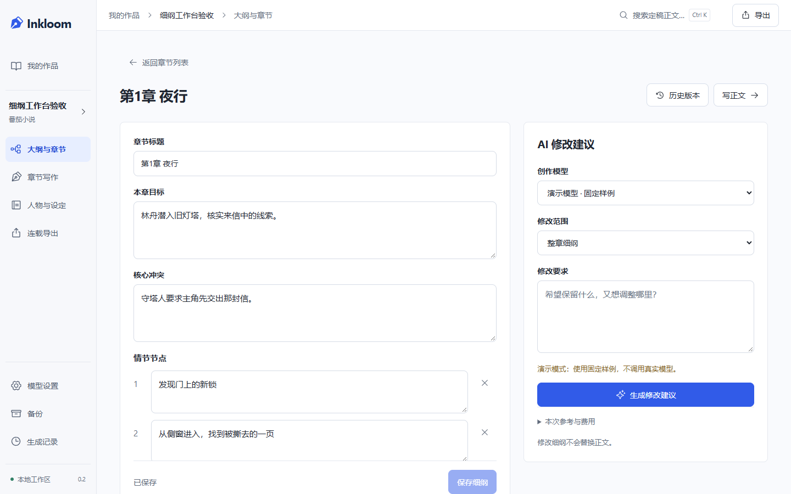

# 章节细纲编辑与 AI 局部修改

2026-10-27 设计，2026-10-28 实现与工程验收。Inkloom 0.2.0。先完成可持续修改的细纲基础，聊天规划和故事脉络图尚未实现；契约见 [决策 0014](decisions/0014-chapter-outline-editing.md)。

本轮沿用此前核查的 [Novelcrafter 章节/场景规划](https://www.novelcrafter.com/help/docs/plan/the-outline-view)、[规划与聊天并用](https://www.novelcrafter.com/help/docs/organization/chat-with-plan) 和 [NovelForge 字段生成与候选确认](https://github.com/RhythmicWave/NovelForge/blob/a485814411546b3980df0a1696a0fb6a043d56ce/README.md)。学习功能组织，独立实现，没有复制竞品源码、提示词或图片。

## 实际使用

在“大纲与章节”点击章节行，进入该章细纲；“写正文”仍直接进入原写作区。编辑章节标题、目标、冲突、最多六个情节节点和章末钩子，明确保存。旧自由文本按原样呈现，支持最多 24,000 字符，不用正则自动拆解；手动转成字段编辑时可对照旧文，保存后仍能从历史恢复。

AI 面板可选择整章细纲或单个字段，填写修改要求；“查看本次参考”只组装上下文，可展开原文依据、模型与费用信息，不生成。点击生成后建立持久化 outline_edit 任务，返回所选范围的候选；作者勾选变化后采纳。未选字段、章节标题和文本格式必须保留，输出和采纳各校验一次。正文、正式记忆和已定稿状态不随细纲改变。

历史列表只加载摘要，可加载更早版本，点击后读取完整快照。恢复产生新修订，不删历史。保存、采纳、恢复和生成回执丢失时锁定原操作参数，显式确认沿用同一个操作号/任务幂等键。

版本冲突保留输入，读取最新细纲作比较后再明确保存。未保存输入写入 IndexedDB，键包含工作区、作品、章节和窗口标识；一个窗口保存不会清除另一个窗口的副本。刷新优先恢复当前窗口，必要时可选择本机已有副本；恢复副本不自动覆盖服务端。离开时提示先保存或放弃，输入法组合期间不提交。

[手机细纲](screenshots/chapter-outline-mobile.png) / [手机 AI 建议](screenshots/chapter-outline-ai-mobile.png)。截图是隔离测试小说。先生成的 [概念图](design/ui-chapter-outline-v1.png) 与 [完整提示词](design/UI-CHAPTER-OUTLINE-IMAGE-PROMPT.md) 保存在设计目录；手机采用单列页签，复用已有组件和设计 token，无新依赖。

## 数据与兼容

同日后续 review 补齐次级编辑入口的 HTTP 基线，并区分旧操作回执与当前细纲状态。旧回执只确认原操作，不使界面退回历史快照，也不自动授权用旧输入覆盖最新内容；重读表单保留作者改动并刷新未编辑字段。详见 [本轮复查](REVIEW-2026-10-28.md)。升级后须刷新旧网页以使用新的更新请求契约，无新数据库迁移。

新增迁移 `e06a5c318d94`，从 `d95f4b207c83` 添加章节 outline_revision 和 outline_revisions 历史表。旧章节从修订 0 开始，首次真实修改时归档旧状态；历史记录按章和修订/操作号唯一，保存完整文档与内容哈希。Plan.structure 保留字段，Chapter.goal 是兼容投影，正文版本不变。

修复旧元数据编辑的结构降级：只改标题/分卷不抹掉结构，未改内容不制造新修订。显式修改旧 goal/body 才作为自由文本编辑，旧结构已在历史中保留。细纲变化递增作品设置修订，已生成候选沿用原失效检查；AI 修改额外冻结细纲修订与原文档。写作助手不误把细纲任务恢复成正文任务，生成记录可以阅读新类型结果。

新备份核验历史归属、文档哈希、修订连续性和当前投影，拒绝重复关联与重复历史修订。支持 `924486b5f963`、`a12c7e604bc9`、`b73d2f809a61`、`c84e3a190b72`、`d95f4b207c83`，先在新目录校验升级，保留原工作区。不支持用旧代码直接打开新库。

## 验证范围

后端针对新功能及生产规划、文风、伏笔的 32 项检查通过；后续修正空自由文本和元数据同步边界后，单独重跑新增 5 项通过。覆盖结构保留、幂等、冲突、历史恢复、指定字段与选择性采纳、旧建议拒绝、正文不变、新备份恢复、旧版升级和篡改拒绝。

桌面与手机六个新增场景完成验证：手动编辑/恢复；生成与采纳及丢失回执；冲突、跨窗口副本保留、刷新恢复和输入法组合。初次为两通过、四处错误提示定位失败，错误实际上已显示；改用 alert 中的文本定位后，对受影响用例补跑通过。截图检查后对历史读取和独立恢复键继续复查；最后补查两端上下文来源点击和 AI 采纳通过。相关构建和 Ruff 通过，未默认重跑全套。

另补跑原有桌面“AI 建书→章节细纲→整章生成→记忆定稿→下一章→连载导出”，1 项通过；这是 Demo 端到端回归，不是真实文学质量验证。

两端编辑页运行 axe 的 WCAG A/AA 自动规则未检出违规，并检查无页面水平溢出；不代表完整可访问性认证。浏览器断线注入日志出现 WinError 10054，相关用例完成通过，保留诊断说明。新恢复窗口使用 sessionStorage 保存非敏感窗口标识，恢复正文仅在 IndexedDB。

升级前对实际工作区制作一致性快照 ZIP，校验完整性、外键和清单哈希；备份在被 Git 忽略的 data/backups/。先将这份真实备份恢复到隔离目录验证升级，再启动本地新版。升级前后八张原有业务表按原列计算摘要一致，细纲修订默认 0、历史为空；HTTP 健康与已有章节细纲只读检查通过，没有为验收修改作者小说。详细命令与结果见 [验证记录](verification/2026-10-28-chapter-outlines.txt)。

未调用真实写作模型，Demo 只证明工程流程。尚未交付持续聊天、剧情脉络图、整批候选采纳前编辑或多章联合改纲，也未证明真实模型文学效果和连载收益。
