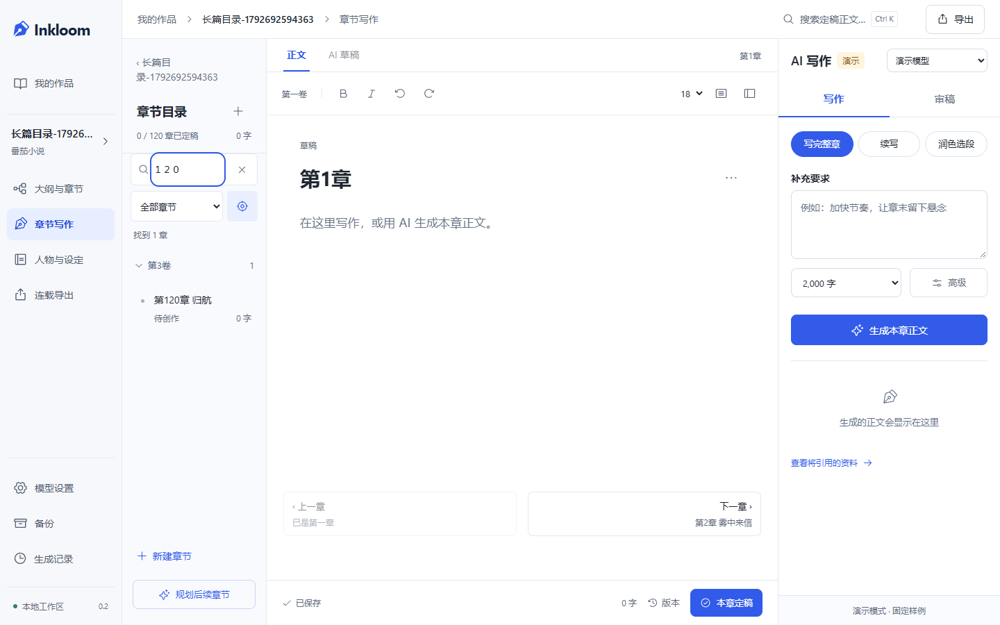

# 长篇目录与参考资料改进

2026-10-23，在 0.2.0 / V4 上迭代。调研、源码入口、许可证核查和取舍见 [决策记录](decisions/0006-longform-navigation-context.md)。

## 已实现

- 章节目录支持搜索章名、卷名、细纲；输入纯数字按章号精确查找，兼容全角数字。
- 支持“全部章节 / 未定稿 / 待复核 / 已定稿”筛选、分卷折叠和定位当前章。当前卷默认展开，过滤结果自动展开；清除筛选可回到完整目录。
- 正文底部增加上一章、下一章。首尾章正确禁用；切章等待保存成功，失败时停留并保留编辑内容。移动端沿用目录抽屉。
- 修复先截断 60 条设定再匹配导致的老人物遗漏。当前章提及的本名、别名与世界规则优先保留，其余设定按更新时间补充；未纳入的数量在参考预览中说明。
- 章节目标和绑定章计划参与检索，两字中文支持字面匹配；未来章计划不用于激活当前人物。
- 全文索引先约束作品、采纳版本、定稿状态、前文顺序，再限制条数。引用仍绑定原文版本和段落；排除参考与硬预算保持生效。

实现文件：`frontend/src/features/ChapterList.tsx`、`EditorPage.tsx`、`lib/chapterDirectory.ts`、`studio.css`、`backend/app/context.py`。没有新增依赖、数据库迁移或 API Schema。

## 实际检查

| 检查 | 本轮结果 |
| --- | --- |
| 后端全套 pytest | **57 passed**；包含新增 5 项长篇上下文用例 |
| Ruff（上下文与新增测试） | 通过 |
| 前端 Vitest | **15 passed** |
| TypeScript + Vite build | 通过 |
| 前后端 API 类型契约 | 一致 |
| 新增 Playwright 流程 | **4 passed**：桌面、手机各验证 120 章目录与切章保存失败保护 |
| 原有关键流程回归 | **10 passed**：桌面、手机各验证保存/刷新/导出/定稿、候选采纳、AI 开书到连载导出、开书恢复、继续未完成章节 |
| 截图检查 | 人工查看 1440×900 桌面、390×844 手机实际截图；新增流程的两种尺寸未检测到页面横向溢出 |

浏览器测试使用独立临时工作区和明确标记的 Demo；没有修改用户作品。不是本轮重跑全部 36 项 E2E，也不声称完成全面可访问性或百万字性能评测。

后端初次在系统 Temp 目录遭遇 `PermissionError: [WinError 5]`，后改用项目内独立 `.tmp` 测试目录。原实现确实失败的两项检索测试已修复。预算测试最初未超过 Demo 的 200000 上下文窗口，改为显式 16000 窗口后通过。浏览器测试修正了加载等待、同名状态定位和跨桌面/手机样例重名问题；没有为通过测试删除业务断言。

最终原始结果见 [验证日志](verification/2026-10-23-longform.txt)。pytest 仍有既有的 Starlette/httpx 弃用警告，不影响本轮通过结果；未为消除警告擅自升级依赖。

## 实际界面

沿用 [V4 概念图](design/ui-workflow-v4.png)，本轮没有新的主要页面或整体布局，不重复生图。

截图由新增 E2E 的独立 120 章空白样例产生，不代表已经用 AI 写完 120 章。

## 仍有的限制

目前是字面与 FTS5 检索，不提供完整语义召回；隐称、同义改写与复杂中文长句仍可能漏检。没有实际调用云模型，未验证真实长篇质量。分卷展开和筛选偏好不跨章节持久化。更完整的伏笔生命周期、批量生成队列和模型接入向导仍是后续事项。本轮没有提交或推送远程仓库。
