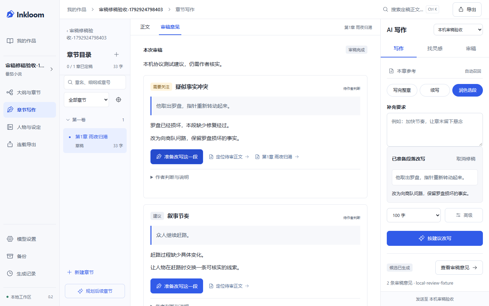

# 审稿到段落修稿与完整生成历史

2026-10-25，Inkloom 0.2.0。本轮依据 [四个热门项目的实际对照](REVIEW-2026-10-25.md)，补齐审稿后修改和早期结果查找两个流程；沿用 V4，不增加开书步骤、数据库迁移或依赖。契约见 [决策 0009](decisions/0009-review-rewrite-history.md)。

## 实际行为

1. 审稿完成后，桌面在中央“审稿意见”页签通读。每条展示待审原文、解释、建议及来源；作者判断与说明收在可展开区域。手机沿用单列助手抽屉。
2. 点击“准备改写这一段”时，先保存作者已输入的正文与本条说明，保留原来的作者判断；服务端读取并核实意见和段落。准备本身不调用模型，不产生新候选，不修改正文。
3. 助手显示只读原段和选中的建议。作者检查写作模型、字数与补充要求，明确点击“按建议改写”后才创建 rewrite 任务。其他审稿意见不作为这次修稿指令传入。
4. 输出仍在候选区。刷新后可返回原审稿、再返回修稿候选，两者都不重新生成；采纳只替换核实过的整段，保留段落外文字和旧稿版本。不自动宣称问题已解决。
5. “生成记录”支持书名、章名、写作要求搜索，以及类型/状态筛选、加载更早记录。先读取 30 条有限摘要，打开记录才读取结果和上下文。分页失败保留已显示记录，可原位重试；显示数量是已加载数量。

新筛选条件从第一页开始；返回此前的筛选条件会恢复其已加载页，这是查询缓存的预期行为。搜索等待中文输入法组合结束后再提交查询。

## 数据与代码边界

- `review_rewrite.py` 根据同书同章的有效审稿、指定正文版本、稳定段落 ID 和可校验原文定位整段。按 Unicode code point 计算选区，保留空行，重复句子不靠第一次字符串匹配定位。
- `ReviewReference` 绑定来源任务、意见索引和意见哈希。只允许用于 rewrite，不能与灵感方向混合使用；选中的意见是作者选择的建议，不升级为正式事实或系统指令。
- 准备、上下文构造、任务完成及采纳均检查依赖。正文、设定、必读参考、依据或选中意见的判断/说明改变后拒绝旧修稿；误报和有意安排不能直接准备。完成与采纳还会重新计算整段范围，防止恢复数据中的选区变化造成改错位置。
- 作者判断接口增加可选的原判断/说明基线。新前端发送基线，冲突保留未保存输入，可读取最新判断后再操作；修改本条意见会使已完成且引用它的修稿候选失效，未选中的意见变化不误伤该候选。旧客户端省略基线时仍兼容，不能宣称旧客户端也有并发说明保护。
- `job_history.py` 按 `(created_at, id)` 降序分页，游标绑定作品、章节、类型、状态与搜索条件。SQL 明确选择名称、状态、有限要求预览等摘要，不加载 `context`、`output_text`、`result`；测试捕获实际 SQL 验证该边界。搜索按字面处理 `%`、`_`。
- 原 `/jobs` 列表保留既有 150 条与旧响应，供恢复等入口兼容；本轮只将生成记录页改用新分页，未声称所有列表都变成轻量查询。
- `ReviewFindings`、`SourceButton` 拆为复用组件，生成记录详情与工作区共用来源展示。接口类型由 OpenAPI 重新生成并校验。

数据库迁移仍为 `b73d2f809a61`。旧上下文缺少审稿引用时使用兼容默认值，不尝试重新解释旧稿或自动发起模型请求；没有执行或承诺向旧版本代码降级。

## 实际验证

| 范围 | 命令与结果 |
| --- | --- |
| 后端集成与回归 | `backend/.venv/Scripts/python.exe -X utf8 -m pytest backend/tests -q --tb=short --basetemp=.tmp/review-final-backend`：134 passed，1 条依赖弃用警告 |
| 后端静态检查 | `backend/.venv/Scripts/ruff.exe check backend/app backend/tests`：通过 |
| API 类型 | `npm --prefix frontend run check:api`：与后端 OpenAPI 一致 |
| 前端单元/契约检查 | `npm --prefix frontend test`：4 个文件、19 项通过 |
| 类型与生产构建 | `npm --prefix frontend run typecheck`、`npm --prefix frontend run build`：通过 |
| 桌面/手机完整回归 | `npm --prefix frontend run test:e2e`：62 项通过 |
| 最后一次选区校验修复后的真实浏览器流程 | `npm --prefix frontend run test:e2e -- review-rewrite.spec.ts --grep '审稿后准备'`：桌面/手机 2 项通过 |
| 固定资料组装评测 | `backend/.venv/Scripts/python.exe -X utf8 evals/run_context_eval.py --output .tmp/review-revision-context-eval.json`：8/8 通过，只证明工程样例 |

原始命令输出与环境范围见 [验证记录](verification/2026-10-25-review-revision.txt)。完整浏览器回归的服务在最后一次选区校验修复前启动，因此修复后额外重启隔离测试服务跑两端的有效采纳流程；后端 134 项已包含该修复。

新增后端用例覆盖：准备无写入、emoji/重复文本/空行、只冻结选中意见、同书同章隔离、来源失效、判断冲突、生成中变化、迟到候选、局部采纳、篡改选区、163 条历史、同时间戳排序、游标作用域和有限 SQL 查询。最后的选区用例先观察到 `DID NOT RAISE DomainError`，修复后通过完整后端回归。

新增 8 项浏览器检查使用真实本地 API、独立 SQLite、Demo 和自建 loopback 协议测试服务器。核对了准备前后调用数、原文未变、刷新往返、明确生成与采纳、两窗口冲突和历史分页失败恢复；没有读取作者作品或请求云模型。早期测试中修正了错误的文本定位器和“清除筛选应丢弃缓存页”的断言，不将失败轮次当作通过记录。

对准备修稿状态运行 axe 的 WCAG 2 A/AA、2.1 AA、2.2 AA 自动规则，两端未检出违规，并检查页面没有水平溢出；实际查看了桌面审稿、手机修稿和历史截图。这不等于完整 WCAG 合规认证、全流程键盘人工验收或完整中文输入法人工测试。

已知检查噪声：pytest 有 Starlette/httpx 弃用提示；完整浏览器回归的模拟断线/重试用例出现一次 Windows asyncio `ConnectionResetError: [WinError 10054]` 关闭回调，相关用例通过，未隐藏该日志或声称已修复其底层原因。Node 的颜色环境变量警告不影响退出状态。

## 界面证据

主要布局先生成 [功能概念图](design/ui-review-revision-v1.png)，[完整提示词与实际取舍](design/UI-REVIEW-REVISION-IMAGE-PROMPT.md) 均已保存。截图中的小说与协议模型是工程样例。

[桌面生成记录](screenshots/job-history-desktop.png) / [手机生成记录](screenshots/job-history-mobile.png)。

## 真实模型与剩余缺口

用户本轮明确选择“先完成工程验证，暂不真实调用”。没有发起真实模型验收，没有费用或文学评分结论；[三次小样本用例](../evals/review-model-pilot-v1.json) 仅为未执行计划。已有模型配置不自动构成付费验收授权。

目前仍需真实模型连续成稿、人工作品通读，以及伏笔生命周期、人物状态演变与文风约束的进一步开发和评测。本轮验证证明上述固定工程流程及边界，不证明模型审稿结论正确、长篇达到平台签约要求或能产生收益。

本地运行：后续确认旧服务已退出、8765 端口空闲，直接通过 `scripts/launch.ps1 -NoBrowser` 启动最新版，启动器完成构建并报告就绪。实际检查健康接口、网页与分页历史均成功，网页引用最新生产 bundle；未停止其他进程、修改作者正文或调用真实模型。首次主动停止并重启的工具拒绝记录及后续处理保留在验证日志。
