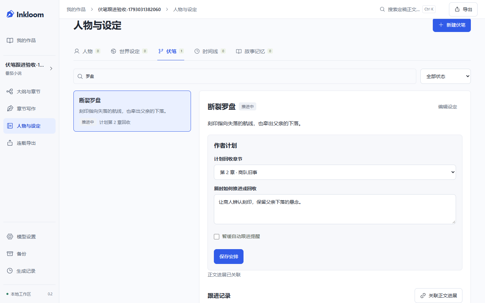
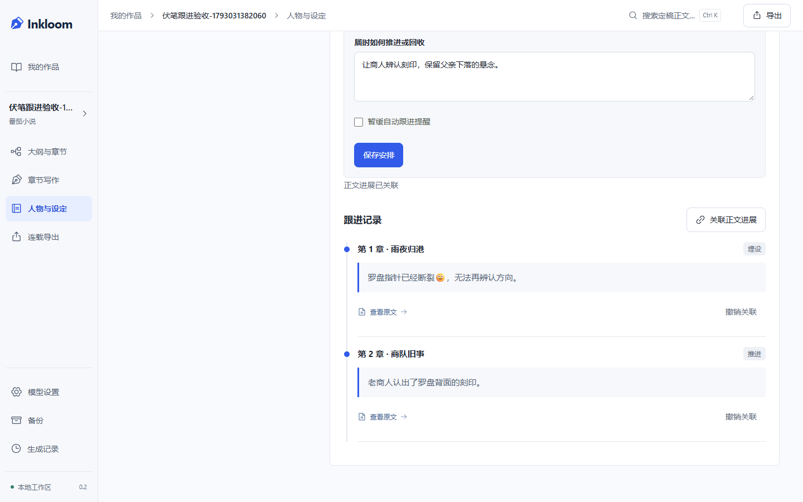

# 伏笔计划与正文跟进

2026-10-26 开发，2026-10-27 收尾验收，Inkloom 0.2.0。延续 [热门项目对照](REVIEW-2026-10-25.md) 中的长篇连续性优先级，补齐伏笔从安排、埋设到回收的作者操作。入口沿用“人物与设定 → 伏笔”，没有新增主导航或模型调用。契约见 [决策 0010](decisions/0010-thread-tracking.md)。

## 实际行为

1. 搜索和筛选已有伏笔，填写计划回收章节、推进安排，或暂缓自动跟进提醒。计划不会变成已经发生的事实。
2. “关联正文进展”选择已定稿章节及段落，标记埋设、推进或回收，可填写作者说明。先显示原文，再明确确认；不改正文、不调用模型。
3. 进展按章序、段序排列，必须先有有效埋设才能推进或回收。回收后不能继续推进；重复埋设、新增或恢复造成的阶段冲突会被拒绝。
4. 查看原文、撤销和恢复保留历史。改稿后旧依据显示待复核，不把过期关联继续当作有效进展。若撤销埋设导致后续缺少前置记录，后续也会显示待复核。
5. 到达计划章节，或本章命中/必读了该伏笔时，写作资料带入此前的有效进展和作者安排。“查看将引用的资料”可检查这次将发送什么；计划是建议，不要求模型为了到期而强行回收。
6. 双窗口修改计划发生冲突时，保留输入，读取最新安排后比较，再由作者保存。关联成功但回执丢失时，重试同一请求，不重复创建记录；重试期间其他窗口的新计划不能被本地未保存的安排静默覆盖。

“暂缓自动跟进提醒”暂停的是跟进资料的自动纳入，不是删除设定；该伏笔设定仍可由普通召回或“本章参考”纳入。取消关联也不会删除正文。

## 实现与迁移

- `ThreadTrack` 保存作者计划和修订，`ThreadProgress` 保存关联来源、阶段、说明和撤销状态。沿用现有 Entity，旧伏笔没有跟进记录时显示计划中。
- `threads.py` 统一检查同书归属、当前定稿版本、稳定段落和引文；写入在事务中校验修订，新增带操作幂等键。计划与关联变化递增作品设置修订，旧候选沿用现有机制失效。
- 当前章及之后的进展完全排除，避免把未来回收结果提前告知前章。超过四条有效进展时保留首次埋设和最近三条，并标明省略数量；相关原文进入必读依据，超预算明确拒绝，不静默丢弃。
- `thread_restore.py` 验证备份中的实体类型、作品、目标章节、版本、范围和引文。过期记录可恢复查看，但不自动成为有效依据。前端 API 类型从 OpenAPI 生成，旧上下文没有 `thread_guidance` 时使用空列表。
- 新增迁移 `c84e3a190b72`，父迁移 `b73d2f809a61`，只新增两张表与索引。备份兼容 `924486b5f963`、`a12c7e604bc9`、`b73d2f809a61` 升级；恢复先在新目录校验和迁移，原工作区保留。没有承诺直接用旧版代码打开新数据库。

作者关联的“回收”只表示作者确认这段原文承担回收作用，不是 AI 或程序对文学效果的客观认证。

## 验证记录

后端最终回归：147 项通过，包括 13 项伏笔集成用例；既有八组上下文固定样例随完整后端回归执行。覆盖阶段顺序、同章段序、未来事件隔离、跨书/错误引文、版本失效、幂等和修订冲突、上下文来源、旧版备份升级及篡改目标章节。

恢复旧埋设与新替代记录冲突的用例先复现 `DID NOT RAISE DomainError`，增加有效记录集合校验后进入上述完整回归。没有用手工更改测试期望掩盖这个缺陷。

API 契约检查通过，Vitest 4 个文件共 19 项通过；最终 `npm --prefix frontend run build` 完成 TypeScript 检查与生产构建。静态检查 `ruff check backend/app backend/tests backend/alembic/versions/c84e3a190b72_thread_tracking.py` 通过。

最终伏笔浏览器用例 8 项通过，覆盖桌面 1440×900 与模拟手机 390×844：搜索与布局、计划持久化、定稿关联、撤销恢复、写作只读此前进展、双窗口冲突、改稿失效、保存回执丢失后的重试与并发计划保护。完整回归中途会话结束，没有取得全套退出结果；已完成部分与后续补跑分别记录，不将中断算作整套通过。

完整套件中已有 56 个成功结果，随后以新构建补跑剩余手机流程 14 项，全部通过；最终伏笔 8 项另行通过。按项目、文件和测试位置去重，共覆盖 70 个桌面/手机场景。最后的修订同步改动仅在伏笔详情组件中，已由最终 8 项重新验证，没有重复执行未受影响的全部场景。命令、失败复现、分段输出和已知警告见 [原始验证记录](verification/2026-10-27-thread-tracking.txt)。

伏笔进展状态运行 axe 的 WCAG 2 A/AA、2.1 AA、2.2 AA 自动规则，两端未检出违规，页面无水平溢出；搜索输入框宽度检查避免筛选框将它挤没。实际查看了桌面与手机的计划、进展截图。这不等于完整可访问性或真实设备认证。

最终并发审查发现：关联回执丢失后，重试可能取得另一窗口的新计划；本地尚未保存的计划不能因此自动取得新修订并覆盖对方。旧构建的浏览器用例已复现未报冲突，修正为只有计划内容未变时才能同步修订，保留双方输入供作者比较。

已知检查提示：pytest 的 Starlette/httpx 弃用警告；浏览器断线场景出现 Windows asyncio `ConnectionResetError: [WinError 10054]` 关闭回调，相关场景通过；Node 颜色环境变量提示。曾尝试对整个 `backend/` 执行 Ruff，发现旧 `alembic/env.py`、初始迁移两处既有导入排序问题，未顺手改写历史迁移；项目规定的 app/tests 范围与新增迁移检查通过。首次临时目录使用系统 Temp 遇到 `PermissionError`，后续按项目脚本改用唯一的 `.tmp/` 子目录，没有修改系统权限。

## 本地升级

2026-10-27 确认原服务已退出后，通过 `scripts/launch.ps1 -NoBrowser` 启动新版。启动前确认无活动生成任务，使用 SQLite backup API 创建含清单的旧版一致性 ZIP，保存在被 Git 忽略的 `data/backups/`；该实际备份已在独立 `.tmp/` 工作区恢复和升级，未切换作者工作区、未启动模型 worker。

实际启动后确认迁移为 `c84e3a190b72`，数据库完整性和外键检查通过，既有小说、章节、正文版本、设定、事实与计划表的行数和内容哈希不变。健康接口、当前生产网页、历史分页和伏笔列表均正常；网址为 `http://127.0.0.1:8765`。未主动停止其他进程，未修改作者正文，未发起模型生成。

## 界面证据

主要布局先通过 imagegen 生成 [概念图](design/ui-thread-tracking-v1.png)，完整提示词和实现差异见 [设计记录](design/UI-THREAD-TRACKING-IMAGE-PROMPT.md)。保留 V4 导航，桌面左右分栏，手机单列；不把图中的示例日期、头像、通知或数量做成假数据。

截图使用隔离测试工作区的自编小说。

[手机安排](screenshots/thread-tracking-mobile.png) / [手机进展](screenshots/thread-progress-mobile.png)。

## 尚未验证或实现

继续遵守用户“先完成工程验证，暂不真实调用”的选择，没有调用已配置的真实模型，也没有费用或文学质量结论。自动从正文提出伏笔关联、人物状态演变、可执行的文风约束仍待开发；真实模型连续十章成稿和作者通读仍需独立验收。

列表目前读取本书伏笔及其进展，未做百万字、海量关联的性能证明。自动可访问性规则与模拟手机浏览器也不能替代完整键盘、真实设备和中文输入法人工验收。
