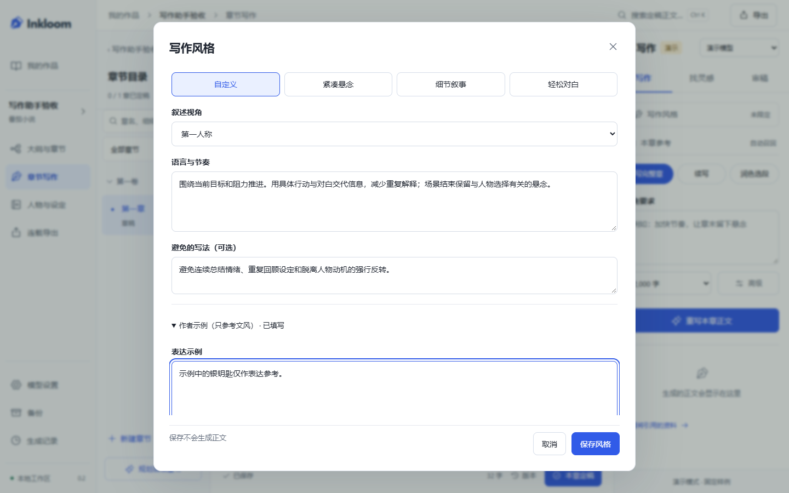
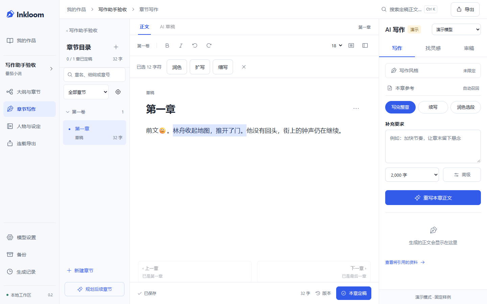

# 作品文风与选段快捷操作

2026-10-27，Inkloom 0.2.0。基于 [四个开源项目的源码与文档对照](REVIEW-2026-10-27.md)，实现作品文风设置和选段快捷准备。契约见 [决策 0012](decisions/0012-writing-style-selection-actions.md)。

## 使用方式

- 在写作助手点“写作风格”，选择预设或填写自己的语言节奏、叙述视角、避免写法及表达示例。预设仅填表，保存不会调用模型；应用于本书后续正文生成、改写和审稿。
- 保存发生冲突时保留输入，读取已保存风格后比较，再明确保存。已有 `Novel.style` 仍是语言与节奏的唯一文本，不另外保存一份互相覆盖的风格要求。
- 选中文字后，正文上方出现润色、扩写、缩写工具条。选择操作先保存并校验选段，助手显示准备好的原文、要求与目标字数；只有点击“生成…候选”才创建模型任务。
- 选段改变或正文版本更新后，旧准备不能直接生成。输出进入原有候选区域，采纳复用版本检查和本地缓冲区保护，段外文字不替换。

作品风格会随小说上下文发送给选中的模型。表达示例只参考文风，不成为前文来源、正式事实或人物知识；审稿中的文风意见也不冒充客观矛盾。本次作者明确补充要求优先于作品默认偏好，不能据此改写已发生事实。

## 数据与边界

新增 `novels.writing_preferences` JSON，存储视角、避免写法和示例。保存绑定作品设置修订，内容相同的确认重试不重复更新；真正变化递增设置修订，旧候选继续受上下文失效检查。

迁移 `d95f4b207c83` 从 `c84e3a190b72` 只添加该字段，现有正文和 style 文本保留。备份兼容 `924486b5f963`、`a12c7e604bc9`、`b73d2f809a61`、`c84e3a190b72`，旧版在新目录验证后升级；新备份核验字段和长度。不支持直接用旧代码打开新库。

文风结构随 continue/rewrite/review 冻结，示例单独标记为非正史材料；不会进入 extract/handoff 的事实提取输入，也不加入可引用原文。原有上下文预算在发送前计入文风资料，超出明确拒绝，不静默删掉作者要求。

快捷操作复用 rewrite Schema 和既有任务，不增加自动 Agent 循环或前端直接调用模型。选区按 Unicode code point 校验，中文输入法组合期间不准备改写；键盘和手机均可操作。用户仍可编辑补充要求，目标字数为建议，不是输出保证。

## 设计与验证

先通过内置 imagegen 生成 [概念图](design/ui-writing-assistance-v1.png)，完整提示词与差异见 [设计记录](design/UI-WRITING-ASSISTANCE-IMAGE-PROMPT.md)。新增界面沿用 V4 和现有模态组件，未引入新依赖。

[手机文风设置](screenshots/writing-style-mobile.png) / [手机选段操作](screenshots/selection-actions-mobile.png)。截图来自隔离测试小说。

后端 7 项针对性检查通过，覆盖文风保存冲突、作品隔离、旧候选失效、示例非事实/非提取输入、预算、新备份恢复、c84 升级和前轮数据边界。API 类型重新生成，TypeScript/生产构建和相关 Ruff 检查通过。

桌面与手机共六个新场景的初次执行为五通过、一处手机状态文案定位失败：实际状态为“演示 · 已采纳”，测试却查找独立的“已采纳”。改用真实任务状态确认后，仅补跑该手机用例通过。各场景核对保存/准备无生成请求、版本变化拒绝旧选段、明确生成及采纳、emoji 之前后的段外文字、双窗口风格冲突。截图复查发现长表单的操作区重叠后，将表单内容改为独立滚动；桌面和手机两项复查通过，并检查内容区不覆盖固定按钮、按钮位于可视范围内。

对风格弹窗与选段工具条运行 axe 的 WCAG 2 A/AA、2.1 AA、2.2 AA 自动规则，两端未检出违规，并检查无页面水平溢出；这不是完整可访问性认证。未重跑全套测试，未调用真实云模型。Demo 和固定样例只证明工程行为，尚不证明实际文风一致性或长篇文学效果。

本地工作区升级前使用 SQLite backup API 制作一致性 ZIP，核对数据库完整性、外键与清单哈希；备份保留在被 Git 忽略的 `data/backups/`。启动后确认迁移为 `d95f4b207c83`，八张原有业务表按原列计算的数据摘要一致，新字段为默认空偏好。HTTP 健康、作品偏好返回、文风路由与当前网页资源核对通过，没有为验收修改作者小说或发起生成。服务地址为 `http://127.0.0.1:8765`。相关命令与结果摘要见 [验证记录](verification/2026-10-27-writing-assistance.txt)。
