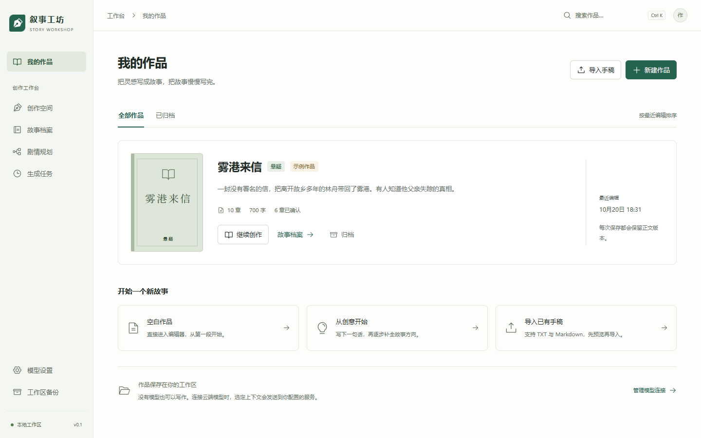
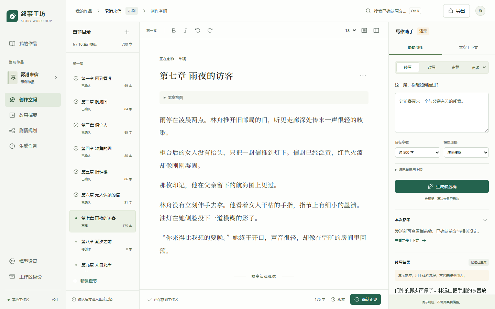

# 0.1.0 实际实现与交付记录

日期：2026-10-20（Asia/Shanghai）。本版是可在 Windows 本地运行的单用户写作工作台。以下是实际实现，不代表所有规划目标已完成，更不代表真实模型文学效果已经验证。

## 可操作的流程

| 范围 | 当前实现 |
| --- | --- |
| 作品 | 新建、书架检索、归档/恢复、原创十章示例；没有模型也能使用 |
| 正文 | Tiptap 基本格式、字号、专注写作、自动保存、Ctrl+S、历史版本与恢复为新版本 |
| 保存保护 | 不可变版本、乐观并发、幂等保存；冲突比较双方，下载本页稿或显式另存；离线保留恢复副本 |
| 生成 | 演示和可配置 Chat Completions 兼容 Provider；六类任务、流式候选、持久化任务/事件、取消、边界暂停、明确重试 |
| 采纳 | 比较后才采纳为新正文版本；原稿或引用发生变化后拒绝直接覆盖；部分输出不可当完整候选 |
| 任务控制 | 每书一个活动任务、原子领取、租约、epoch、Attempt、检查点；中断未知不自动重发，次数与可判断预算受代码约束 |
| 资料与规划 | 人物/别名、世界、伏笔、时间线的作者设定；作品简报、文风与全书/卷/章/场景规划 |
| 正史 | 先提议、校验出处，再由作者逐章确认；手动整理也可用；修改前文使对应后缀事实、索引和候选失效 |
| 来源 | 绑定作品/章节/不可变版本/段落/hash/精确原文与码点范围；只读弹层回看指定版本并标记引用 |
| 检索 | 作品与有效正史限定的 FTS5、中文短词回退和人物别名扩展；没有向量/语义检索 |
| 审稿 | Schema 与两侧来源校验；问题可标记确认、有意安排、误报或稍后，并记录作者说明；缺证不冒充确定矛盾 |
| 导入/导出 | TXT / Markdown、显式中文编码、章切分预览与修正；工作稿/有效正史两种导出范围 |
| 备份 | SQLite backup API 一致快照、manifest/hash；恢复到新目录，核验库/正文/段落/引用后切换；可返回原工作区 |
| 安全 | 默认回环地址；Host/Origin/本地会话；后端 DPAPI 密钥保管；禁跟随 Provider 重定向；恢复不激活旧凭证引用 |

所有页面连接本机 API。书架、字数、状态、版本、费用和任务数来自数据库。演示响应与示例作品有明确标识；不伪造质量分数、模型进度或调用量。

## 运行与开发入口

```powershell
pwsh -File .\scripts\setup.ps1
pwsh -File .\scripts\start.ps1
pwsh -File .\scripts\test.ps1 -Browser
```

默认地址 `http://127.0.0.1:8765`，默认工作区 `data/`。`start.ps1 -Build` 重建网页再运行；`dev.ps1` 使用 Vite 开发服务。安装依赖后也可运行 backend 的 `python -m app`，但应在 `backend/` 中使用其虚拟环境。

初始 Alembic 迁移为 `924486b5f963`，应用在启动时升级。0.1.0 尚未有已发行旧版的升级承诺；未来更改数据库须增加迁移，不能删库重建来“升级”。实现结构和与原方案的差异见 [ADR 0001](adr/0001-local-workspace.md)。

## 验证范围

实际自动检查输出保存在 [2026-10-20-tests.txt](verification/2026-10-20-tests.txt)。最终结果在下方记录，不把规划中的 A01—A24 列表当作全量通过证明。发布日志仅将本机绝对路径脱敏为 `<project>`，未修改检查结果。

<!-- verification-result -->
最终命令：`pwsh -File .\scripts\test.ps1 -Browser`，退出码 **0**。

| 实际检查 | 结果 |
| --- | --- |
| Ruff | 通过 |
| pytest，临时 SQLite / 本机协议与故障注入 | **43 passed** |
| OpenAPI / 前端声明同步 | 通过 |
| Vitest，共享 Unicode 与路由契约 | **9 passed** |
| TypeScript strict + Vite 正式构建 | 通过，页面按需拆分，无超大 chunk 警告 |
| Playwright，1440×900 桌面与 390×844 手机视口 | **24 passed** |
| axe，编辑器与助手扫描状态 | 两种视口未发现所选规则集的违规 |
| 1440 / 1024 / 768 / 390 宽度 | 正文区域可见，body 未横向溢出；数值见视口记录 |
| Markdown 本地链接 / PowerShell 语法 | 检查通过 |
| 生产网页中的测试凭证标记 | 四个 canary 均未检出 |

环境：Windows，PowerShell 7，Node.js 24.19.0，Python 3.13.0，Chrome 155.0.8059.85。启动脚本已实际运行，应用返回健康状态。

保留的工具提示：Starlette 测试客户端对当前 HTTPX 适配器有弃用提示；测试仍通过，后续应更新测试适配器。Playwright 环境另有 NO_COLOR / FORCE_COLOR 提示，不是应用失败。这些原始输出均保留在验证日志中。
<!-- /verification-result -->

后端测试使用真实临时 SQLite；传输测试使用只监听本机的可计数 HTTP 协议服务器。覆盖正常流式、最终空 choices 的 usage、断流未知、限流、截断、非法结构/引用、取消后迟到结果、租约过期、存储故障与 worker 继续执行、跨书隔离、幂等和预算。另有十章演示生成/采纳/提取/确认与第 3 章改写后的逐章重建。

浏览器流程实际操作手写、刷新、版本、导出、正史、候选采纳、改稿后拒绝旧候选、两页冲突、离线重试、提取来源、emoji 选段、手稿导入、备份恢复和提交响应失败后的幂等重试。两种视口均使用本机 Chrome，不代表真实手机硬件测试。

自动 axe 范围是编辑器和写作助手的已扫描状态，检查 WCAG 2/2.1/2.2 A/AA 相关规则；不能由此声称整个产品、所有状态和屏幕阅读器已完全符合 WCAG。

## 真实界面

先生成概念再实现，来源与映射见 [UI 实现说明](design/IMPLEMENTATION-DESIGN.md)。下列是应用实际截图，示例作品的原文字数只有约七百字，未使用概念图里虚构的统计。






[手机正文](screenshots/editor-mobile.png) · [手机助手](screenshots/assistant-mobile.png) · [视口测量记录](screenshots/viewport-checks.json)

## 尚未验证与限制

- **未调用真实云端模型。** 本地协议服务器和固定演示响应证明工程路径，不能证明任意供应商、真实模型效果或文学质量。需要作者在本机配置合法连接后独立验证。
- Markdown 导入/导出目前以章节标题与正文文字为主，不是完整富文本格式转换器；正文版本仍保留编辑器支持的基本格式。
- 没有实际 Windows 拼音输入法的人工操作记录。组合输入事件有保护，浏览器填充与 emoji 选段成功不等于 IME 人工验收。
- 没有做 48 个语义标准场景、盲评、百万字性能、长期稳定性、全量键盘/屏幕阅读器或 Safari / Firefox 实测。
- worker 当前在应用进程内顺序执行，重启按持久化状态恢复判断；尚无独立 worker CLI、多用户或分布式执行。
- 费用是配置价格与粗略 token 估算/返回 usage 的结果，缺失保持未知；不能承诺供应商实际账单绝不超出估算。
- 伏笔、时间线和关系目前以记录/档案表达，没有复杂关系图、完整分支、批量无人值守写书、云同步或自动发布。

已做本机浏览器检查与截图查看；尚无来自真实作者长期使用的体验结论。源码同步目标为用户指定的 [spark0v0/Inkloom](https://github.com/spark0v0/Inkloom)，只包含源码、文档与示例设计素材，不包含本机作品或凭证；没有开放公网或修改生产服务。
