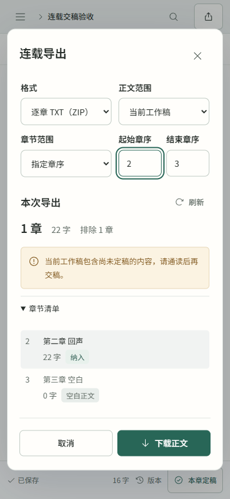

# 结项交付与最终竞品对照

2026-10-31。Inkloom 本轮作为 **0.2.0 本地测试版**完成工程功能收尾。可以开始由作者通读、修改和逐章定稿的创作；本次没有进行真实模型成稿或平台投稿验收，不承诺无人值守生成、平台签约或收益。

## 本次对比与取舍

核查项目的公开 README 和官方文档，没有安装竞品、复用代码或比较真实模型文学效果。下表描述来源中的功能及本项目的选择，不按功能数量或 stars 推断质量。

| 对照项目 | 值得借鉴的做法 | 本次取舍 |
| --- | --- | --- |
| [AI_NovelGenerator](https://github.com/YILING0013/AI_NovelGenerator) | 世界、分卷、情节弧、场景和章节计划分层；AI 候选由作者审阅保存 | 沿用已有全书方案、分卷、细纲、候选和定稿闭环。场景编排涉及新的状态与上下文契约，未在收尾阶段扩入 |
| [MuMuAINovel](https://github.com/xiamuceer-j/MuMuAINovel) / [公开 README](https://raw.githubusercontent.com/xiamuceer-j/MuMuAINovel/main/README.md) | 开书向导、文风、灵感、审稿改写、伏笔及资料导入导出 | Inkloom 已有相应的核心写作入口，继续保持本地单作者部署。原生多协议、关系图和可视化提示词工坊仍有差距，不为功能对齐迁移数据库或引入登录平台 |
| [NovelForge](https://github.com/RhythmicWave/NovelForge) | 持续灵感讨论、所选卡片引用、结构化生成及明确区分单次生成和长期对话 | 已有三方向灵感、指定资料、细纲局部修改与单条意见修稿；持续聊天仍未交付，不能把单次任务历史宣传为聊天会话 |
| [Novelcrafter 导出](https://www.novelcrafter.com/help/docs/export/novel) | 作者选择所需章节和内容再导出 | 本轮直接落实指定章序范围、实际导出预览、排除原因和版本变化检查。保留 TXT/Markdown/按章 TXT ZIP，无模型开销 |
| [Sudowrite 导出](https://docs.sudowrite.com/using-sudowrite/1ow1qkGqof9rtcyGnrWUBS/exporting-files/3NtVWXcnwYaRCmPW2iwcCB) | 区分单篇、项目和故事资料的交付 | 正文导出与完整工作区备份继续分开；正文不夹带细纲、人物档案、记忆或凭证。完整恢复使用已有备份流程 |

调研结论：当前最值得补齐的是作者实际交稿前的选择和确认。继续扩大聊天、图谱或多 Agent 功能，会引入新的验收范围；它们未完成并不妨碍使用现有逐章流程试写，但仍须明确列为缺口。

## 最后完成的功能优化

- **范围导出：** 全部章节或起始—结束章序；默认仅导出已定稿。可明确切换工作稿，适合整理当天更新或指定卷段。
- **实际预览：** 显示纳入章数、正文字符数、逐章清单及空白、尚未定稿、待重新定稿等排除原因。统计沿用项目字符计数，不声称与平台字数完全一致。
- **版本保护：** 预览、TXT、Markdown 和 ZIP 共用同一选择规则。下载携带预览指纹，章节或版本变化时拒绝旧请求；刷新后由作者再次点击下载，不自动重试。
- **空稿修复：** 原先 TXT/Markdown 即使没有正文也会下载只有书名的文件，现在与 ZIP 一样明确拒绝空导出。
- **代码整理：** 导出查询与渲染独立到 `backend/app/manuscript_export.py`，前端窗口独立到 `features/ExportDialog.tsx`。预览只读元数据；实际下载通过同一条关联查询取得版本信息和被纳入正文，不逐章加载完整版本 JSON。API 类型由 OpenAPI 重新生成。
- **合并前轮改进：** 自动前文与记忆在预算不足时有序裁剪，保留章末衔接和明确必读；统一配色和本地中文字体，支持保存阅读字体及字号偏好。

导出契约见 [决策 0020](decisions/0020-serial-export-preview.md)，前文预算见 [本轮主流程 review](REVIEW-2026-10-31.md)，视觉细化见 [字体与配色记录](design/IMPLEMENTATION-TYPOGRAPHY-2026-10-31.md)。无数据库迁移，无新增运行依赖，无真实模型调用。

## 实际验证

| 检查 | 实际结果 |
| --- | --- |
| 后端导出、连载规划/采纳与前文预算 | 18 项通过；Ruff 通过 |
| 前端基础逻辑 | 8 个文件、36 项通过 |
| 类型及生产构建 | `npm.cmd --prefix frontend run build` 通过 |
| API 契约 | `npm.cmd --prefix frontend run check:api` 通过 |
| 桌面/手机核心流程 | 8 项通过，56.2 秒：范围 ZIP 导出；保存后导出、旧预览冲突及明确重试；手写保存与定稿；演示 AI 开书、细纲、写作、记忆、下一章到导出 |
| 手机导出窗口细化后复查 | 范围导出桌面/手机 2 项再次通过；同次 axe 自动检查零违规 |

所有验证使用独立临时 SQLite 工作区、虚构测试材料与本地演示响应，未访问作者小说或读取真实密钥。系统临时目录权限受限时，pytest 改用项目 `.tmp/closure-pytest-<随机值>` 下的新目录，没有修改系统目录权限。

已知验证输出：Starlette/httpx 弃用警告；完整浏览器流程关闭流连接时，Windows Proactor 打印过 `ConnectionResetError: [WinError 10054]`，对应流程仍通过。这些输出未被隐藏；本轮没有为消除环境/弃用告警而扩入不相关依赖升级。

自动检查与示例流程不证明真实模型文学质量、完整 WCAG 合规、跨浏览器表现或百万字性能。

## 实际界面

沿用已有工作台概念图，仅细化现有导出窗口。截图使用虚构验收作品。

## 接下来如何使用

1. 拉取代码后正常停止旧服务，双击 `启动 Inkloom.cmd`；启动器按变更重新构建。先在备份页面保存已有工作区的备份。
2. 使用自己的模型连接，从一部作品的前三章开始，按“细纲 → 候选 → 通读修改 → 本章定稿 → 下一章”推进；详见 [试写指南](START-WRITING.md)。
3. 交稿前打开“连载导出”，选择当天所需章序，检查字数和被排除章节；下载后由作者自行上传平台。
4. 修改早期定稿后，按提示复核后文；定期备份。正文导出用于交稿，不能替代完整工作区备份。

## 保留的边界

仍未交付持续规划聊天、完整场景级生成、有限多章自动改纲、语义向量记忆、原生多协议、DOCX/EPUB、云同步和多人协作。真实模型连续十章效果、返工和费用、完整中文输入法人工体验及百万字基准仍未验收。

因此本轮交付定位是**可供作者开始试写的本地工具**。工程收尾不等于平台收稿或商业效果验证；保留测试版标识，不以结项为由虚报 1.0 质量保证。
