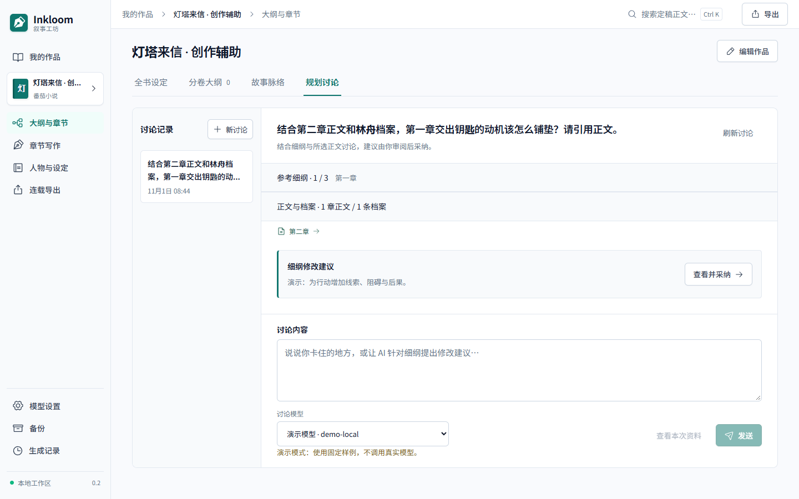
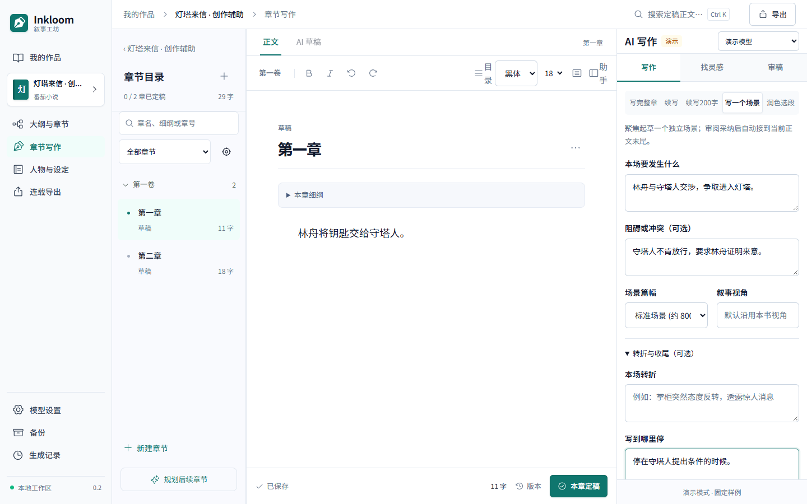
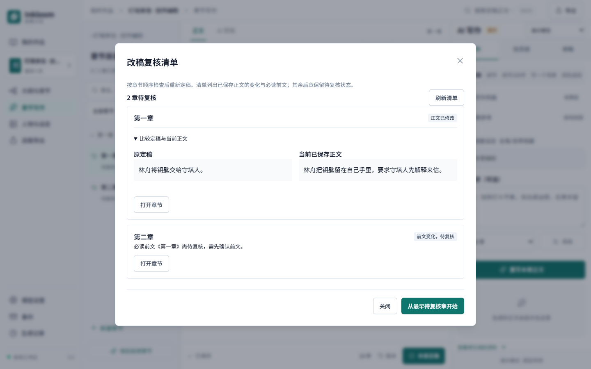

# 正文讨论、轻量场景与改稿复核

2026-11-01。对应 [决策 0023](../decisions/0023-manuscript-discussions-and-scene-writing.md)。三项能力在接手时已存在于提交 `84d5e22`，本轮检查实际行为、修复边界并补齐验证。保持 0.2.0 本地测试版；没有真实收费模型调用。

## 规划讨论选择资料

“大纲与章节 → 规划讨论”保留一至三章完整细纲的范围，额外允许明确选择同书最多三章已保存正文、十二条作者档案。未选择时不直接读取正文或档案；历史讨论可能含先前资料的引文，仍标记为历史建议。界面可展开范围并通过“查看本次资料”核对将发送的内容。

正文绑定不可变版本，携带章节、段落、哈希与草稿/定稿身份；所选档案按当时快照组装。选定材料完整纳入，预算不足先让较早讨论和可选规划让出空间，仍超限则要求缩小范围。预览、实际消息、指纹和估算来自同次组装。`discussion_sources.py` 管范围与来源，`discussions.py` 管历史、任务及细纲采纳，使用 `discuss-v2.md`。

模型原文引用必须是所选版本中的原句，服务端补齐并校验版本与范围。正文、档案或细纲变化后，旧回复仍可读，旧提案不能继续写入。提案一次最多改一章声明的细纲字段，不改正文或定稿记忆。恢复副本保留选择与原请求，重试使用同一幂等号；旧请求新增空默认字段不会变成新调用。

备份恢复增加两层核验：实际 user 消息必须与输入快照一致；回复引用的作品、版本与范围不能伪造。`discuss-v1` 不能借兼容格式夹带新正文/档案范围，合法旧任务继续可读与重放。跨作品选择、伪造原句及损坏恢复均在隔离测试中检查，失败不切换原工作区。

[手机截图](../screenshots/authoring-discussion-mobile.png)。手机沿用已有讨论选择框、独立消息滚动与输入区，本轮收紧长标题，避免挤占输入空间。

## 写一个场景

章节助手选择“写一个场景”，填写“本场要发生什么”，可补充冲突、转折、收尾及视角，明确生成后调用模型。`SceneIntent` 随 `continue` 请求冻结，`scene-v1.md` 将它作为未来要求处理；结果先进入现有候选区。只有采纳才追加到生成时的正文基线并产生新版本，旧稿保留；原稿已变化时仍须处理冲突。

它没有独立场景目录、场景卡片版本或自动节拍循环。前章未定稿或待复核时可继续草拟，但自动上下文不因此使用这些前文；明确必读失效仍拒绝生成，本章定稿继续检查章节顺序。短续写约 200 字也追加到正文末尾，不能称为光标插入。

提交回执未确认时，场景目标、冲突、篇幅、视角、转折与收尾一起锁定；“确认上次提交”重放同一冻结请求，不用新幂等号另建任务。复查修复了此前场景字段位于锁定表单之外、界面值可能与原请求不一致的问题。

[手机截图](../screenshots/scene-writing-mobile.png)。整章、一般续写、短续写和场景分别恢复篇幅要求，避免短续写的 200 字误带入整章生成。

## 改稿后的复核清单

修改已定稿前文后，通过“改稿复核清单”查看待复核章。`GET /novels/{id}/review-impact` 只读取章节元数据与本页参考，默认每页 30 章；分页携带资料指纹，状态变化后要求刷新。清单打开时不加载全部历史正文，展开某章比较后才读取原定稿与当前已保存版本。

清单区分本章正文改变与前文变化造成的待复核，列出明确必读参考的版本变化，并可从最早待复核章开始检查。它保留保守失效策略，不能判断语义上是否真的受影响，不能自动确认或批量跳过后章。不调用模型、不写记忆或定稿状态。

[手机截图](../screenshots/review-impact-mobile.png)。比较按需展开，长正文独立滚动。

## 验证范围

后端覆盖版本与来源、跨书隔离、预算、过期提案、旧幂等回执、场景候选追加与旧版本保留、复核清单只读/分页及伪造备份拒绝。浏览器覆盖资料选择、引用回看、刷新恢复、明确采纳、场景追加及复核跳转，并在 1440×900 和 390×844 的相关区域运行 axe。实际命令和结果见 [复查报告](../reviews/REVIEW-2026-11-01.md) 与 [验证记录](../verification/2026-11-01-review.txt)。

截图使用虚构样例，模型输出为固定演示或测试模拟；这些检查不证明真实模型的规划、场景文学效果、长期一致性或费用。历史讨论分页、词法召回和后章保守失效仍是当前限制。
